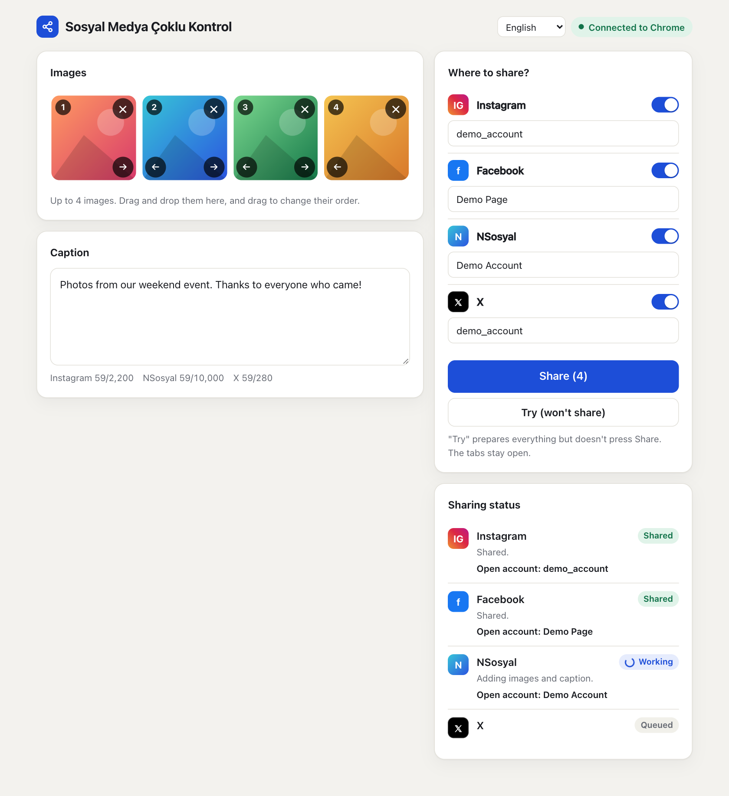
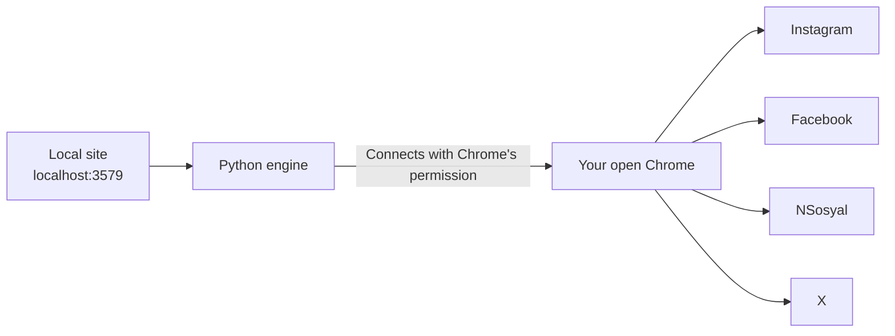

# Sosyal Medya Çoklu Kontrol

**English** · [Türkçe](docs/README.tr.md) · [Español](docs/README.es.md) · [Português](docs/README.pt.md) · [Français](docs/README.fr.md) · [Deutsch](docs/README.de.md) · [Русский](docs/README.ru.md) · [العربية](docs/README.ar.md) · [简体中文](docs/README.zh.md) · [日本語](docs/README.ja.md)

Prepare your images and caption on one screen, then share them to **Instagram, Facebook, NSosyal and X** with one button.

The program runs on your own computer and uses the Chrome where your accounts are already signed in. It doesn't ask for or store passwords, and it doesn't send your data to any other server.



## Features

- **One screen, four platforms:** Up to 4 images and one caption go to every platform you choose.
- **Uses your own Chrome:** It works with your existing sessions and doesn't need a separate window or a new login.
- **Try mode:** Prepares everything but doesn't press Share. Nothing is published until you decide.
- **Account check:** If the open account doesn't match the one you saved, not even an image is added on that platform.
- **Duplicate post protection:** If the result can't be verified, it doesn't retry automatically. It asks you to check instead.
- **Failure isolation:** If one platform fails, the others continue and the failed tab stays open.
- **Waits if you're signed out:** It brings the login screen to the front and continues once you sign in.
- **Comfortable interface:** Drag and drop, image ordering, character counters, dark theme and phone-width layout.
- **10 interface languages:** English, Turkish, Spanish, Portuguese, French, German, Russian, Arabic, Chinese and Japanese. It follows your browser's language, and you can change it from the menu at the top of the page.

## Installation

**You need:** [Google Chrome](https://www.google.com/chrome/) and [Python 3.10 or newer](https://www.python.org/downloads/). On Windows, tick **Add python.exe to PATH** while installing Python.

1. Extract the folder to a permanent place such as the Desktop. Don't run it from inside the zip.
2. Double-click the launcher:

| System | File |
|---|---|
| Windows | `baslat.bat` |
| macOS | `baslat.command` |

The first launch installs what's needed, which can take a minute or two and requires internet. After that, the site opens directly in Chrome.

> If Windows shows "Windows protected your PC", choose **More info → Run anyway**. If macOS blocks it, go to **System Settings → Privacy & Security → Open Anyway**.

## Usage

### 1. Connect to Chrome (first time)

1. Open `chrome://inspect/#remote-debugging` in Chrome.
2. Tick **Allow remote debugging for this browser instance**.
3. On the site, press **Connect to Chrome**, and choose **Allow** if Chrome asks.

Chrome may ask for permission again each time the program is reopened.

### 2. Save your accounts (once)

1. Sign in through Chrome with the accounts you want to share from.
2. Add an image and press **Try**. Nothing is shared.
3. If the account shown in the status section is right, press **Save this account**.

The saved name must match what the site shows. Instagram and X use the username. Facebook and NSosyal use the display name, such as the full Page name. If the names differ, the program stops on that platform without sharing. **Save this account** enters the right name for you.

To share as a Facebook Page, switch to that Page in Chrome first.

### 3. Share

Add your images, write the caption, choose the platforms, press **Share** and confirm the summary. Successful tabs close after 30 seconds. You can change this with the `kapanmaSuresiSn` value in `data/ayarlar.json`.

### What the statuses mean

| Status | Meaning | What to do |
|---|---|---|
| Shared | The post was verified | Nothing |
| Ready | Try mode finished, nothing was shared | Check the tab and close it without pressing Share |
| Waiting for login | You're signed out | Sign in on the opened tab |
| Check it | The button was pressed but the result couldn't be verified | See whether the post appeared before deciding what to do |
| Error | Not shared | Read the message. A screenshot is in the `data/hatalar` folder |

## How it works



A new tab opens for each platform, and these steps run in order: session check, account check, adding images, typing the caption, sharing and verifying the result. The program only touches the tabs it opened. When it closes, it doesn't close Chrome, it only disconnects.

## Folder structure

```text
sosyal-medya-coklu-kontrol/
├── baslat.bat            Windows launcher
├── baslat.command        macOS launcher
├── KULLANIM.txt          Short usage note (Turkish)
├── LICENSE               MIT license
├── requirements.txt      Python dependencies
├── app/
│   ├── __main__.py       Entry point
│   ├── server.py         Local website
│   ├── engine.py         Sharing engine
│   ├── platforms.py      Platform-specific steps
│   ├── messages.py       Translatable messages
│   └── static/           Interface
│       └── i18n/         Interface translations
├── scripts/              Packaging and screenshot scripts
├── tests/                Automated tests
├── docs/                 README translations and screenshots
└── data/                 Account names, error screenshots (not in git)
```

If a platform changes its interface, `app/platforms.py` is the file to fix.

## Security and privacy

- The site can only be reached from this computer (`127.0.0.1`). Requests from other sites are rejected.
- Passwords, cookies and session data are neither read nor stored. The program saves only account names and the error records in `data/hatalar`.
- While Chrome's remote debugging box is ticked, programs on the computer may ask for permission to connect to Chrome. Don't approve a permission window you weren't expecting. On a shared computer, untick the box when you're done.
- Screenshots and the `kayit.txt` log in the `data/hatalar` folder can contain account names and account content. Share them only with people you trust.

## Known limits and risks

> **Important:** This program uses the web interfaces, not the official platform APIs. Platform rules may restrict this kind of automation. For example, X's rules are reported to penalize automated actions through its website, up to account suspension. The decision to use it and the responsibility are yours. Review the rules first for important accounts.

- **Site languages:** The interface language setting only changes this program. Instagram and Facebook must be set to English or Turkish, because their buttons are found by their text. In other site languages, the program stops with an error without sharing anything. NSosyal is expected to be in Turkish. X doesn't depend on the site language.
- The launcher's black window shows its messages in Turkish and English only.
- The translations were written with AI and haven't been reviewed by native speakers. Corrections are welcome.
- Steps may stop working when platforms change their interfaces.
- It doesn't try to get past verification screens or bot protection. You need to solve those yourself.
- The computer and Chrome must stay on while the program is working.
- Limits per image vary by platform. JPEG, PNG and WebP are supported, video isn't.
- Keep Instagram's "Share to → Facebook" option off, or the post will appear twice on Facebook.
- After a partly failed share, turn off the platforms that already shared before pressing **Share** again, or the post will appear twice on them.

### Test status

| Area | Status |
|---|---|
| Automated tests (with fake sites), including all 10 interface languages | Passing |
| Preparation, multiple images and account check on the real sites (macOS, Turkish-language sites) | Tried in Try mode |
| Pressing Share on the real sites | Worked in one real test on Windows |
| Reading the account in Facebook Page mode | **Not tried yet** |
| Running on Windows | Worked in one real test |

Make your first real share on one platform, with an unimportant post.

## Troubleshooting

| Problem | Solution |
|---|---|
| "Python 3.10 or newer was not found" | Install Python. On Windows, tick **Add python.exe to PATH** |
| "Couldn't connect to Chrome" | Check that Chrome is open, the box is ticked and the permission window was approved |
| "The open account couldn't be read" | Enlarge the Chrome window so the sites' side menus are visible |
| "Wrong account is open" | Switch to the right account in Chrome or correct the saved account name |
| "The post screen wasn't found" | Set the site's language to English or Turkish. If it already is, the site's interface may have changed: look in the `data/hatalar` folder |
| Port already in use | The program is already open. Go to `http://localhost:3579` |

## Development

```bash
python3 -m venv .venv
.venv/bin/python -m pip install -r requirements.txt
.venv/bin/python -m app
```

The tests don't touch real accounts or your Chrome. They use a separate Chrome with a temporary profile and fake sites:

```bash
.venv/bin/python -m unittest tests.test_end_to_end
```

Packaging writes its output to the `dist/` folder:

```bash
.venv/bin/python scripts/paketle.py
```

To add a language, add its file to `app/static/i18n/` and its name to `LANGUAGES` in `app/static/index.html`. The tests check that every language has the same keys.

## License

[MIT](LICENSE). The software is provided without any warranty.
