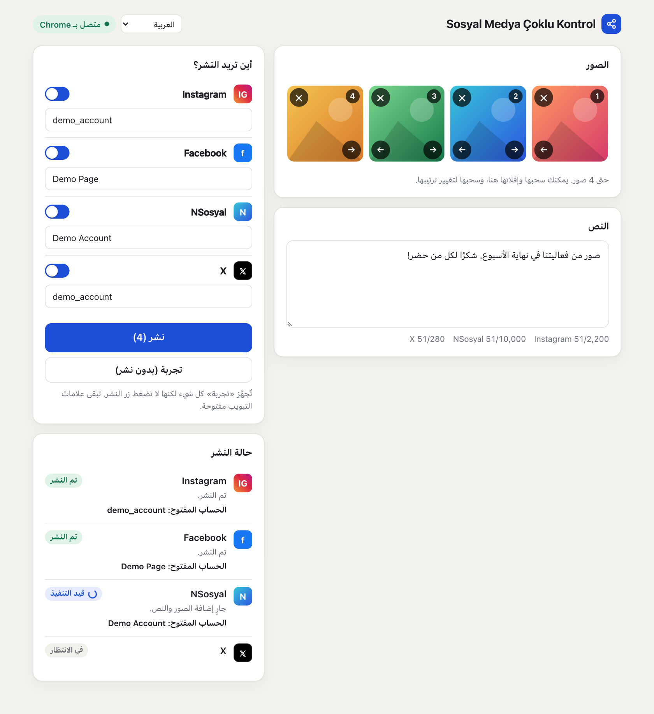
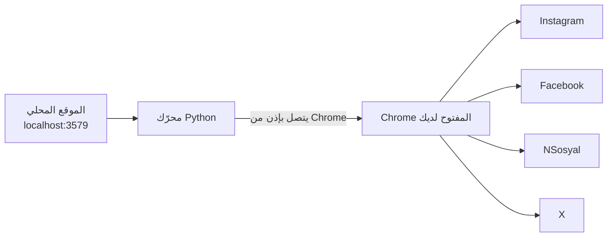

<div dir="rtl">

# Sosyal Medya Çoklu Kontrol

[English](../README.md) · [Türkçe](README.tr.md) · [Español](README.es.md) · [Português](README.pt.md) · [Français](README.fr.md) · [Deutsch](README.de.md) · [Русский](README.ru.md) · **العربية** · [简体中文](README.zh.md) · [日本語](README.ja.md)

جهّز صورك والنص المرافق لها في شاشة واحدة، ثم انشرها على **Instagram وFacebook وNSosyal وX** بضغطة زر واحدة.

يعمل البرنامج على جهازك أنت، ويستخدم متصفح Chrome الذي سجّلت الدخول فيه إلى حساباتك. لا يطلب كلمات المرور ولا يخزّنها، ولا يرسل بياناتك إلى أي خادم آخر.



## المزايا

- **شاشة واحدة وأربع منصات:** ما يصل إلى 4 صور ونص واحد يُرسلان إلى كل المنصات التي تختارها.
- **يستخدم Chrome الخاص بك:** يعمل مع جلساتك الحالية ولا يحتاج إلى نافذة منفصلة أو تسجيل دخول جديد.
- **وضع التجربة:** يجهّز كل شيء لكنه لا يضغط على «نشر». لا يُنشر شيء حتى تقرّر أنت.
- **التحقق من الحساب:** إذا لم يطابق الحساب المفتوح الحساب الذي حفظته، فلن تُضاف حتى صورة واحدة على تلك المنصة.
- **الحماية من النشر المكرر:** إذا تعذّر التحقق من النتيجة، فلا يعيد المحاولة تلقائيًا، بل يطلب منك التحقق بنفسك.
- **عزل الأعطال:** إذا فشلت منصة واحدة، تواصل المنصات الأخرى عملها وتبقى علامة التبويب المتعثرة مفتوحة.
- **ينتظر إذا خرجت من حسابك:** يُظهر شاشة تسجيل الدخول في المقدمة ويكمل عمله بمجرد تسجيل دخولك.
- **واجهة مريحة:** السحب والإفلات، وترتيب الصور، وعدّادات الأحرف، والمظهر الداكن، وتخطيط يناسب عرض الهاتف.
- **10 لغات للواجهة:** الإنجليزية والتركية والإسبانية والبرتغالية والفرنسية والألمانية والروسية والعربية والصينية واليابانية. يتبع لغة متصفحك، ويمكنك تغييرها من القائمة أعلى الصفحة.

## التثبيت

**ما تحتاج إليه:** [Google Chrome](https://www.google.com/chrome/) و[Python 3.10 أو أحدث](https://www.python.org/downloads/). في Windows، فعّل الخيار **Add python.exe to PATH** أثناء تثبيت Python.

1. فك ضغط المجلد في مكان دائم مثل سطح المكتب. لا تشغّله من داخل ملف zip.
2. انقر نقرًا مزدوجًا على ملف التشغيل:

| النظام | الملف |
|---|---|
| Windows | `baslat.bat` |
| macOS | `baslat.command` |

عند التشغيل الأول يُثبَّت ما يلزم، وقد يستغرق ذلك دقيقة أو دقيقتين ويتطلب اتصالًا بالإنترنت. بعد ذلك يُفتح الموقع مباشرة في Chrome.

> إذا عرض Windows رسالة «حماية Windows جهاز الكمبيوتر»، فاختر **مزيد من المعلومات ← تشغيل على أي حال**. وإذا حظره macOS، فانتقل إلى **إعدادات النظام ← الخصوصية والأمن ← فتح على أي حال**.

## الاستخدام

### 1. الاتصال بـ Chrome (في المرة الأولى)

1. افتح `chrome://inspect/#remote-debugging` في Chrome.
2. فعّل الخيار **Allow remote debugging for this browser instance**.
3. في الموقع، اضغط **الاتصال بـ Chrome**، ثم اختر **السماح** إذا طلب Chrome ذلك.

قد يطلب Chrome الإذن مجددًا في كل مرة يُعاد فيها تشغيل البرنامج.

### 2. حفظ حساباتك (مرة واحدة)

1. سجّل الدخول عبر Chrome بالحسابات التي تريد النشر منها.
2. أضف صورة واضغط **تجربة**. لن يُنشر شيء.
3. إذا كان الحساب الظاهر في قسم الحالة صحيحًا، فاضغط **حفظ هذا الحساب**.

للنشر بصفتك صفحة Facebook، انتقل أولًا إلى تلك الصفحة في Chrome.

### 3. النشر

أضف صورك، واكتب النص، واختر المنصات، ثم اضغط **نشر** وأكّد الملخص. تُغلق علامات التبويب الناجحة بعد 30 ثانية. يمكنك تغيير ذلك عبر القيمة `kapanmaSuresiSn` في `data/ayarlar.json`.

### معنى الحالات

| الحالة | المعنى | ما العمل |
|---|---|---|
| تم النشر | تم التحقق من المنشور | لا شيء |
| جاهز | انتهى وضع التجربة ولم يُنشر شيء | افحص علامة التبويب وأغلقها دون الضغط على «نشر» |
| بانتظار تسجيل الدخول | لقد خرجت من حسابك | سجّل الدخول في علامة التبويب التي فُتحت |
| تحقّق | ضُغط الزر لكن تعذّر التحقق من النتيجة | تأكّد من ظهور المنشور قبل أن تقرّر ما تفعله |
| خطأ | لم يُنشر | اقرأ الرسالة. توجد لقطة شاشة في المجلد `data/hatalar` |

## كيف يعمل



تُفتح علامة تبويب جديدة لكل منصة وتُنفَّذ الخطوات التالية بالترتيب: التحقق من الجلسة، والتحقق من الحساب، وإضافة الصور، وكتابة النص، والنشر، والتحقق من النتيجة. لا يلمس البرنامج إلا علامات التبويب التي فتحها بنفسه. وعند إغلاقه لا يغلق Chrome، بل يقطع الاتصال فقط.

## بنية المجلدات

```text
sosyal-medya-coklu-kontrol/
├── baslat.bat            ملف التشغيل لنظام Windows
├── baslat.command        ملف التشغيل لنظام macOS
├── KULLANIM.txt          ملاحظة قصيرة للاستخدام (بالتركية)
├── LICENSE               رخصة MIT
├── requirements.txt      اعتماديات Python
├── app/
│   ├── __main__.py       نقطة الدخول
│   ├── server.py         الموقع المحلي
│   ├── engine.py         محرّك النشر
│   ├── platforms.py      الخطوات الخاصة بكل منصة
│   ├── messages.py       الرسائل القابلة للترجمة
│   └── static/           الواجهة
│       └── i18n/         ترجمات الواجهة
├── scripts/              سكربتات التحزيم ولقطات الشاشة
├── tests/                الاختبارات الآلية
├── docs/                 ترجمات README ولقطات الشاشة
└── data/                 أسماء الحسابات ولقطات الأخطاء (لا تُضاف إلى git)
```

إذا غيّرت منصة ما واجهتها، فالملف الذي يجب إصلاحه هو `app/platforms.py`.

## الأمان والخصوصية

- لا يمكن الوصول إلى الموقع إلا من هذا الجهاز (`127.0.0.1`). تُرفض الطلبات القادمة من المواقع الأخرى.
- لا تُقرأ كلمات المرور وملفات تعريف الارتباط وبيانات الجلسات ولا تُخزَّن. الشيء الوحيد المحفوظ هو أسماء الحسابات.
- ما دام مربع التصحيح عن بُعد في Chrome مفعّلًا، قد تطلب البرامج على الجهاز إذنًا للاتصال بـ Chrome. لا توافق على نافذة إذن لم تكن تتوقعها. على جهاز مشترك، ألغِ تفعيل المربع عند الانتهاء.
- قد تحتوي لقطات الشاشة في المجلد `data/hatalar` على محتوى من الحسابات. شاركها فقط مع من تثق بهم.

## الحدود والمخاطر المعروفة

> **مهم:** يستخدم هذا البرنامج واجهات الويب، لا واجهات برمجة التطبيقات (API) الرسمية للمنصات. قد تقيّد قواعد المنصات هذا النوع من الأتمتة. فعلى سبيل المثال، يُذكر أن قواعد X تعاقب الإجراءات الآلية عبر موقعها حتى تعليق الحساب. قرار الاستخدام والمسؤولية عليك. راجع القواعد أولًا إذا كانت الحسابات مهمة.

- **لغات المواقع:** إعداد لغة الواجهة يغيّر هذا البرنامج فقط. يجب ضبط Instagram وFacebook على الإنجليزية أو التركية، لأن أزرارهما تُعرف من نصوصها. في أي لغة أخرى للموقع يتوقف البرنامج بخطأ دون أن ينشر شيئًا. يُتوقع أن يكون NSosyal بالتركية. أما X فلا يعتمد على لغة الموقع.
- تعرض النافذة السوداء الخاصة بملف التشغيل رسائلها بالتركية والإنجليزية فقط.
- كُتبت الترجمات بالذكاء الاصطناعي ولم يراجعها متحدثون أصليون. التصحيحات مرحَّب بها.
- قد تتوقف الخطوات عن العمل عندما تغيّر المنصات واجهاتها.
- لا يحاول البرنامج تجاوز شاشات التحقق أو الحماية من الروبوتات. عليك حلّها بنفسك.
- يجب أن يبقى الجهاز وChrome قيد التشغيل أثناء عمل البرنامج.
- تختلف حدود الصورة الواحدة من منصة إلى أخرى. يُدعم JPEG وPNG وWebP، ولا يُدعم الفيديو.
- أبقِ خيار «Share to → Facebook» في Instagram متوقفًا، وإلا سيظهر المنشور مرتين على Facebook.

### حالة الاختبار

| المجال | الحالة |
|---|---|
| الاختبارات الآلية (بمواقع وهمية)، بما فيها لغات الواجهة العشر كلها | ناجحة |
| التجهيز وتعدد الصور والتحقق من الحساب على المواقع الحقيقية (macOS، مواقع باللغة التركية) | جُرّب في وضع التجربة |
| الضغط على «نشر» على المواقع الحقيقية | **لم يُجرَّب بعد** |
| قراءة الحساب في وضع صفحة Facebook | **لم يُجرَّب بعد** |
| التشغيل على Windows | **لم يُجرَّب بعد** |

اجعل أول نشر حقيقي لك على منصة واحدة، ومع منشور غير مهم.

## استكشاف الأخطاء وإصلاحها

| المشكلة | الحل |
|---|---|
| "Python 3.10 or newer was not found" | ثبّت Python. في Windows فعّل الخيار **Add python.exe to PATH** |
| «تعذّر الاتصال بـ Chrome» | تأكّد من أن Chrome مفتوح، وأن المربع مفعّل، وأنك وافقت على نافذة الإذن |
| «تعذّرت قراءة الحساب المفتوح، فتوقف العمل حرصًا على الأمان» | كبّر نافذة Chrome ليظهر الشريط الجانبي للمواقع |
| «الحساب المفتوح خاطئ» | انتقل إلى الحساب الصحيح في Chrome أو صحّح اسم الحساب المحفوظ |
| «لم يُعثر على شاشة النشر» | اضبط لغة الموقع على الإنجليزية أو التركية. وإذا كانت كذلك بالفعل، فربما تغيّرت واجهة الموقع: انظر في المجلد `data/hatalar` |
| المنفذ قيد الاستخدام | البرنامج مفتوح بالفعل. انتقل إلى `http://localhost:3579` |

## التطوير

```bash
python3 -m venv .venv
.venv/bin/python -m pip install -r requirements.txt
.venv/bin/python -m app
```

لا تلمس الاختبارات حسابات حقيقية ولا Chrome الخاص بك. فهي تستخدم Chrome منفصلًا بملف تعريف مؤقت ومواقع وهمية:

```bash
.venv/bin/python -m unittest tests.test_end_to_end
```

تكتب عملية التحزيم مخرجاتها في المجلد `dist/`:

```bash
.venv/bin/python scripts/paketle.py
```

لإضافة لغة، ضع ملفها في `app/static/i18n/` وأضف اسمها إلى `LANGUAGES` في `app/static/index.html`. تتحقق الاختبارات من أن لكل لغة المفاتيح نفسها.

## الرخصة

[MIT](../LICENSE). يُقدَّم البرنامج دون أي ضمان.

</div>
