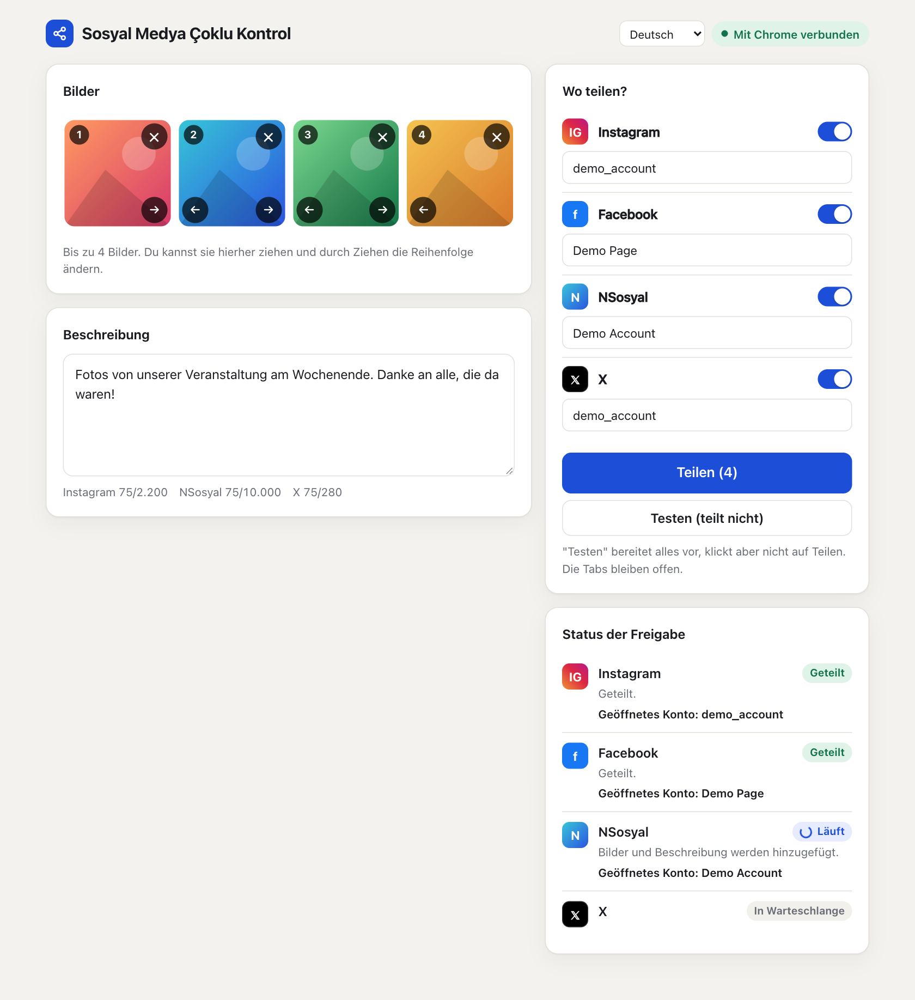
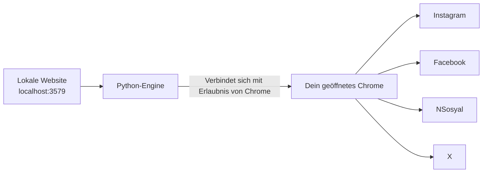

# Sosyal Medya Çoklu Kontrol

[English](../README.md) · [Türkçe](README.tr.md) · [Español](README.es.md) · [Português](README.pt.md) · [Français](README.fr.md) · **Deutsch** · [Русский](README.ru.md) · [العربية](README.ar.md) · [简体中文](README.zh.md) · [日本語](README.ja.md)

Bereite deine Bilder und den Text auf einem Bildschirm vor und teile sie mit einem Klick auf **Instagram, Facebook, NSosyal und X**.

Das Programm läuft auf deinem eigenen Computer und nutzt das Chrome, in dem deine Konten bereits angemeldet sind. Es fragt nicht nach Passwörtern, speichert keine und sendet deine Daten an keinen anderen Server.



## Funktionen

- **Ein Bildschirm, vier Plattformen:** Bis zu 4 Bilder und ein Text gehen an jede Plattform, die du auswählst.
- **Nutzt dein eigenes Chrome:** Es arbeitet mit deinen bestehenden Sitzungen und braucht weder ein separates Fenster noch eine neue Anmeldung.
- **Testmodus:** Bereitet alles vor, drückt aber nicht auf Teilen. Es wird nichts veröffentlicht, bevor du es entscheidest.
- **Kontoprüfung:** Stimmt das geöffnete Konto nicht mit dem gespeicherten überein, wird auf dieser Plattform nicht einmal ein Bild hinzugefügt.
- **Schutz vor doppelten Beiträgen:** Lässt sich das Ergebnis nicht bestätigen, versucht es nicht automatisch erneut, sondern bittet dich, nachzusehen.
- **Fehlerisolierung:** Schlägt eine Plattform fehl, machen die anderen weiter und der betroffene Tab bleibt offen.
- **Wartet, wenn du abgemeldet bist:** Es holt die Anmeldeseite in den Vordergrund und macht weiter, sobald du dich angemeldet hast.
- **Komfortable Oberfläche:** Drag and drop, Bilder sortieren, Zeichenzähler, dunkles Design und Layout für Handybreite.
- **10 Oberflächensprachen:** Englisch, Türkisch, Spanisch, Portugiesisch, Französisch, Deutsch, Russisch, Arabisch, Chinesisch und Japanisch. Es folgt der Sprache deines Browsers und lässt sich über das Menü oben auf der Seite ändern.

## Installation

**Du brauchst:** [Google Chrome](https://www.google.com/chrome/) und [Python 3.10 oder neuer](https://www.python.org/downloads/). Setze unter Windows bei der Python-Installation das Häkchen bei **Add python.exe to PATH**.

1. Entpacke den Ordner an einen festen Ort wie den Desktop. Starte ihn nicht direkt aus der Zip-Datei.
2. Doppelklicke auf das Startprogramm:

| System | Datei |
|---|---|
| Windows | `baslat.bat` |
| macOS | `baslat.command` |

Beim ersten Start wird installiert, was nötig ist. Das kann ein bis zwei Minuten dauern und braucht Internet. Danach öffnet sich die Seite direkt in Chrome.

> Wenn Windows „Der Computer wurde durch Windows geschützt“ anzeigt, wähle **Weitere Informationen → Trotzdem ausführen**. Wenn macOS es blockiert, gehe zu **Systemeinstellungen → Datenschutz & Sicherheit → Trotzdem öffnen**.

## Verwendung

### 1. Mit Chrome verbinden (beim ersten Mal)

1. Öffne in Chrome `chrome://inspect/#remote-debugging`.
2. Setze das Häkchen bei **Allow remote debugging for this browser instance**.
3. Klicke auf der Seite auf **Mit Chrome verbinden** und wähle **Zulassen**, falls Chrome nachfragt.

Chrome fragt möglicherweise bei jedem erneuten Start des Programms wieder nach der Erlaubnis.

### 2. Konten speichern (einmalig)

1. Melde dich in Chrome mit den Konten an, über die du teilen möchtest.
2. Füge ein Bild hinzu und klicke auf **Testen**. Es wird nichts geteilt.
3. Wenn das im Statusbereich angezeigte Konto stimmt, klicke auf **Dieses Konto speichern**.

Der gespeicherte Name muss mit dem übereinstimmen, was die Website anzeigt. Instagram und X verwenden den Benutzernamen. Facebook und NSosyal verwenden den Anzeigenamen, zum Beispiel den vollständigen Seitennamen. Wenn die Namen abweichen, stoppt das Programm auf dieser Plattform, ohne zu teilen. **Dieses Konto speichern** trägt den richtigen Namen für dich ein.

Um als Facebook-Seite zu teilen, wechsle in Chrome zuerst zu dieser Seite.

### 3. Teilen

Füge deine Bilder hinzu, schreibe den Text, wähle die Plattformen, klicke auf **Teilen** und bestätige die Zusammenfassung. Erfolgreiche Tabs schließen sich nach 30 Sekunden. Diesen Wert kannst du über `kapanmaSuresiSn` in `data/ayarlar.json` ändern.

### Was die Status bedeuten

| Status | Bedeutung | Was zu tun ist |
|---|---|---|
| Geteilt | Der Beitrag wurde bestätigt | Nichts |
| Bereit | Der Testmodus ist abgeschlossen, es wurde nichts geteilt | Prüfe den Tab und schließe ihn, ohne auf Teilen zu klicken |
| Warten auf Anmeldung | Du bist abgemeldet | Melde dich im geöffneten Tab an |
| Prüfen | Die Schaltfläche wurde gedrückt, aber das Ergebnis ließ sich nicht bestätigen | Sieh nach, ob der Beitrag erschienen ist, bevor du entscheidest, was du tust |
| Fehler | Nicht geteilt | Lies die Meldung. Ein Screenshot liegt im Ordner `data/hatalar` |

## So funktioniert es



Für jede Plattform wird ein neuer Tab geöffnet und diese Schritte laufen nacheinander ab: Sitzungsprüfung, Kontoprüfung, Bilder hinzufügen, Text eingeben, teilen und das Ergebnis bestätigen. Das Programm berührt nur die Tabs, die es selbst geöffnet hat. Beim Beenden schließt es Chrome nicht, sondern trennt nur die Verbindung.

## Ordnerstruktur

```text
sosyal-medya-coklu-kontrol/
├── baslat.bat            Startprogramm für Windows
├── baslat.command        Startprogramm für macOS
├── KULLANIM.txt          Kurze Anleitung (Türkisch)
├── LICENSE               MIT-Lizenz
├── requirements.txt      Python-Abhängigkeiten
├── app/
│   ├── __main__.py       Einstiegspunkt
│   ├── server.py         Lokale Website
│   ├── engine.py         Teilen-Engine
│   ├── platforms.py      Plattformspezifische Schritte
│   ├── messages.py       Übersetzbare Meldungen
│   └── static/           Oberfläche
│       └── i18n/         Übersetzungen der Oberfläche
├── scripts/              Skripte für Paketierung und Screenshots
├── tests/                Automatische Tests
├── docs/                 README-Übersetzungen und Screenshots
└── data/                 Kontonamen, Fehler-Screenshots (nicht in git)
```

Wenn eine Plattform ihre Oberfläche ändert, ist `app/platforms.py` die Datei, die angepasst werden muss.

## Sicherheit und Datenschutz

- Die Seite ist nur von diesem Computer aus erreichbar (`127.0.0.1`). Anfragen von anderen Websites werden abgelehnt.
- Passwörter, Cookies und Sitzungsdaten werden weder gelesen noch gespeichert. Das Programm speichert nur Kontonamen und die Fehlerprotokolle in `data/hatalar`.
- Solange das Kästchen für das Remote-Debugging in Chrome aktiviert ist, können Programme auf dem Computer um die Erlaubnis bitten, sich mit Chrome zu verbinden. Bestätige kein Berechtigungsfenster, das du nicht erwartet hast. Deaktiviere das Kästchen auf einem gemeinsam genutzten Computer, wenn du fertig bist.
- Screenshots und das Protokoll `kayit.txt` im Ordner `data/hatalar` können Kontonamen und Kontoinhalte enthalten. Teile sie nur mit Personen, denen du vertraust.

## Bekannte Grenzen und Risiken

> **Wichtig:** Dieses Programm nutzt die Weboberflächen, nicht die offiziellen APIs der Plattformen. Die Regeln der Plattformen können solche Automatisierung einschränken. Den Regeln von X wird zum Beispiel nachgesagt, dass sie automatisierte Aktionen über die Website bis hin zur Sperrung des Kontos ahnden. Die Entscheidung zur Nutzung und die Verantwortung liegen bei dir. Lies bei wichtigen Konten zuerst die Regeln.

- **Sprache der Websites:** Die Einstellung der Oberflächensprache ändert nur dieses Programm. Instagram und Facebook müssen auf Englisch oder Türkisch eingestellt sein, weil ihre Schaltflächen anhand ihres Textes gefunden werden. Bei anderen Sprachen der Website bricht das Programm mit einem Fehler ab, ohne etwas zu teilen. NSosyal sollte auf Türkisch sein. X hängt nicht von der Sprache der Website ab.
- Das schwarze Fenster des Startprogramms zeigt seine Meldungen nur auf Türkisch und Englisch an.
- Die Übersetzungen wurden mit KI geschrieben und nicht von Muttersprachlern geprüft. Korrekturen sind willkommen.
- Schritte können aufhören zu funktionieren, wenn Plattformen ihre Oberfläche ändern.
- Es versucht nicht, Verifizierungsbildschirme oder Bot-Schutz zu umgehen. Das musst du selbst lösen.
- Computer und Chrome müssen eingeschaltet bleiben, solange das Programm arbeitet.
- Die Grenzen pro Bild unterscheiden sich je nach Plattform. JPEG, PNG und WebP werden unterstützt, Video nicht.
- Lass bei Instagram die Option „Share to → Facebook“ ausgeschaltet, sonst erscheint der Beitrag zweimal auf Facebook.
- Wenn das Teilen auf einigen Plattformen fehlgeschlagen ist, schalte die bereits erfolgreichen Plattformen aus, bevor du erneut auf **Teilen** klickst, sonst erscheint der Beitrag dort zweimal.

### Teststatus

| Bereich | Status |
|---|---|
| Automatische Tests (mit gefälschten Websites), einschließlich aller 10 Oberflächensprachen | Bestanden |
| Vorbereitung, mehrere Bilder und Kontoprüfung auf den echten Websites (macOS, türkischsprachige Websites) | Im Testmodus ausprobiert |
| Klick auf Teilen auf den echten Websites | Hat in einem echten Test unter Windows funktioniert |
| Konto auslesen im Modus Facebook-Seite | **Noch nicht ausprobiert** |
| Ausführung unter Windows | Hat in einem echten Test funktioniert |

Mach dein erstes echtes Teilen auf nur einer Plattform und mit einem unwichtigen Beitrag.

## Fehlerbehebung

| Problem | Lösung |
|---|---|
| "Python 3.10 or newer was not found" | Installiere Python. Setze unter Windows das Häkchen bei **Add python.exe to PATH** |
| „Verbindung zu Chrome fehlgeschlagen“ | Prüfe, ob Chrome geöffnet ist, das Kästchen aktiviert ist und das Berechtigungsfenster bestätigt wurde |
| „Das geöffnete Konto konnte nicht gelesen werden, aus Sicherheitsgründen gestoppt“ | Vergrößere das Chrome-Fenster, damit die Seitenmenüs der Websites sichtbar sind |
| „Falsches Konto geöffnet“ | Wechsle in Chrome zum richtigen Konto oder korrigiere den gespeicherten Kontonamen |
| „Der Beitragsbildschirm wurde nicht gefunden“ | Stelle die Sprache der Website auf Englisch oder Türkisch. Ist sie das schon, hat sich vielleicht die Oberfläche der Website geändert: Sieh im Ordner `data/hatalar` nach |
| Port bereits belegt | Das Programm ist schon geöffnet. Gehe zu `http://localhost:3579` |

## Entwicklung

```bash
python3 -m venv .venv
.venv/bin/python -m pip install -r requirements.txt
.venv/bin/python -m app
```

Die Tests berühren weder echte Konten noch dein Chrome. Sie verwenden ein separates Chrome mit temporärem Profil und gefälschte Websites:

```bash
.venv/bin/python -m unittest tests.test_end_to_end
```

Die Paketierung schreibt ihre Ausgabe in den Ordner `dist/`:

```bash
.venv/bin/python scripts/paketle.py
```

Um eine Sprache hinzuzufügen, lege ihre Datei in `app/static/i18n/` ab und trage ihren Namen in `LANGUAGES` in `app/static/index.html` ein. Die Tests prüfen, dass jede Sprache dieselben Schlüssel hat.

## Lizenz

[MIT](../LICENSE). Die Software wird ohne jegliche Gewährleistung bereitgestellt.
