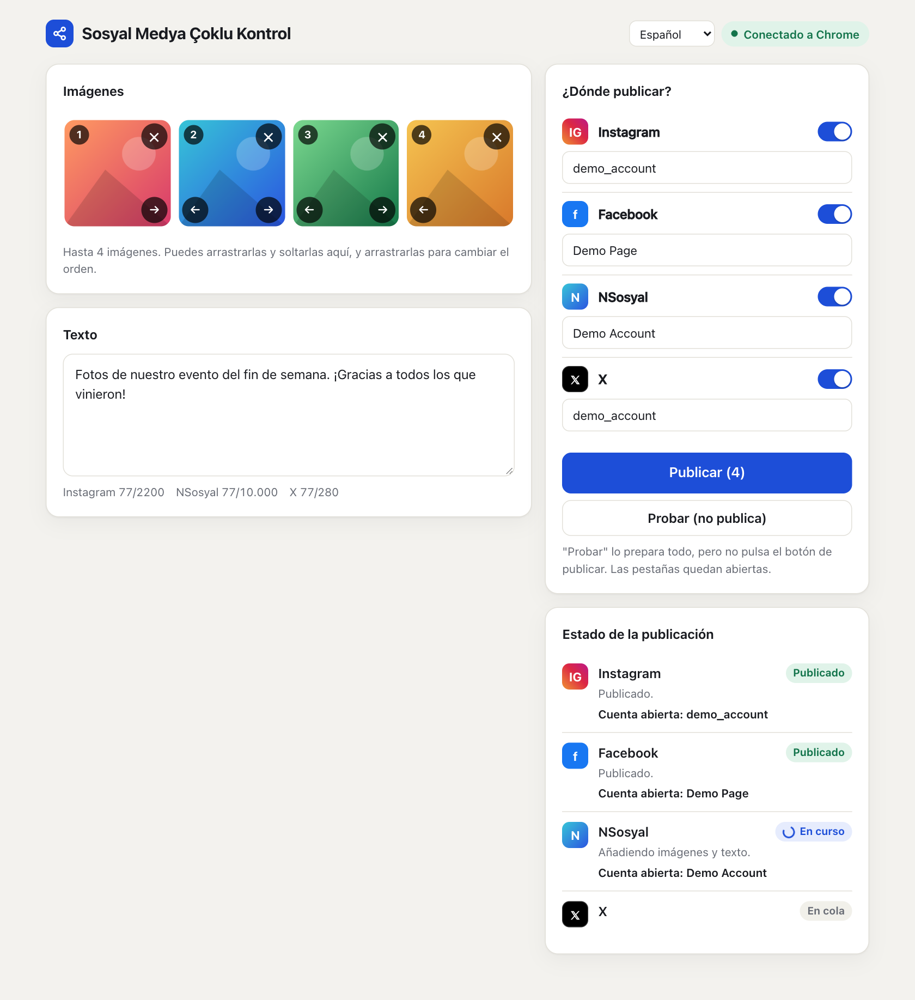
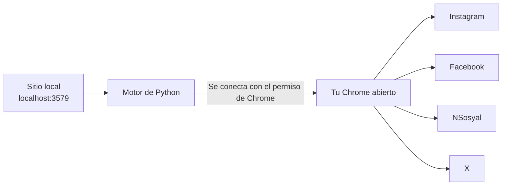

# Sosyal Medya Çoklu Kontrol

[English](../README.md) · [Türkçe](README.tr.md) · **Español** · [Português](README.pt.md) · [Français](README.fr.md) · [Deutsch](README.de.md) · [Русский](README.ru.md) · [العربية](README.ar.md) · [简体中文](README.zh.md) · [日本語](README.ja.md)

Prepara tus imágenes y el texto en una sola pantalla y publícalos en **Instagram, Facebook, NSosyal y X** con un solo botón.

El programa se ejecuta en tu propio ordenador y usa el Chrome en el que ya tienes las cuentas abiertas. No pide ni guarda contraseñas, y no envía tus datos a ningún otro servidor.



## Características

- **Una pantalla, cuatro plataformas:** hasta 4 imágenes y un texto van a todas las plataformas que elijas.
- **Usa tu propio Chrome:** funciona con tus sesiones actuales y no necesita otra ventana ni un nuevo inicio de sesión.
- **Modo de prueba:** lo prepara todo, pero no pulsa Publicar. No se publica nada hasta que tú decidas.
- **Comprobación de cuenta:** si la cuenta abierta no coincide con la que guardaste, en esa plataforma ni siquiera se añade una imagen.
- **Protección contra publicaciones duplicadas:** si no se puede verificar el resultado, no reintenta automáticamente. Te avisa para que lo revises.
- **Fallos aislados:** si una plataforma falla, las demás continúan y la pestaña con el problema se queda abierta.
- **Espera si se cierra la sesión:** trae la pantalla de inicio de sesión al frente y continúa cuando entras.
- **Interfaz cómoda:** arrastrar y soltar, orden de imágenes, contadores de caracteres, tema oscuro y diseño adaptado al ancho del móvil.
- **10 idiomas de interfaz:** inglés, turco, español, portugués, francés, alemán, ruso, árabe, chino y japonés. Sigue el idioma de tu navegador y puedes cambiarlo desde el menú de la parte superior de la página.

## Instalación

**Necesitas:** [Google Chrome](https://www.google.com/chrome/) y [Python 3.10 o superior](https://www.python.org/downloads/). En Windows, marca **Add python.exe to PATH** al instalar Python.

1. Extrae la carpeta en un lugar permanente, como el Escritorio. No la ejecutes desde dentro del zip.
2. Haz doble clic en el lanzador:

| Sistema | Archivo |
|---|---|
| Windows | `baslat.bat` |
| macOS | `baslat.command` |

La primera vez se instala lo necesario, lo que puede tardar uno o dos minutos y requiere internet. Después, el sitio se abre directamente en Chrome.

> Si Windows muestra «Windows protegió su PC», elige **Más información → Ejecutar de todas formas**. Si macOS lo bloquea, ve a **Ajustes del Sistema → Privacidad y seguridad → Abrir igualmente**.

## Uso

### 1. Conectar con Chrome (la primera vez)

1. Abre `chrome://inspect/#remote-debugging` en Chrome.
2. Marca **Allow remote debugging for this browser instance**.
3. En el sitio, pulsa **Conectar a Chrome** y elige **Permitir** si Chrome te lo pide.

Chrome puede volver a pedir permiso cada vez que se reabre el programa.

### 2. Guardar tus cuentas (una sola vez)

1. Inicia sesión en Chrome con las cuentas desde las que quieres publicar.
2. Añade una imagen y pulsa **Probar**. No se publica nada.
3. Si la cuenta que aparece en la sección de estado es la correcta, pulsa **Guardar esta cuenta**.

Para publicar como Página de Facebook, cambia primero a esa Página en Chrome.

### 3. Publicar

Añade tus imágenes, escribe el texto, elige las plataformas, pulsa **Publicar** y confirma el resumen. Las pestañas que terminan bien se cierran a los 30 segundos. Puedes cambiarlo con el valor `kapanmaSuresiSn` de `data/ayarlar.json`.

### Qué significa cada estado

| Estado | Significado | Qué hacer |
|---|---|---|
| Publicado | La publicación se verificó | Nada |
| Listo | El modo de prueba terminó, no se publicó nada | Revisa la pestaña y ciérrala sin pulsar Publicar |
| Esperando inicio de sesión | Has cerrado la sesión | Inicia sesión en la pestaña que se abrió |
| Revisar | Se pulsó el botón, pero no se pudo verificar el resultado | Mira si apareció la publicación antes de decidir qué hacer |
| Error | No se publicó | Lee el mensaje. Hay una captura de pantalla en la carpeta `data/hatalar` |

## Cómo funciona



Para cada plataforma se abre una pestaña nueva y se ejecutan estos pasos en orden: comprobación de sesión, comprobación de cuenta, añadir las imágenes, escribir el texto, publicar y verificar el resultado. El programa solo toca las pestañas que abrió él mismo. Al cerrarse no cierra Chrome, solo se desconecta.

## Estructura de carpetas

```text
sosyal-medya-coklu-kontrol/
├── baslat.bat            Lanzador para Windows
├── baslat.command        Lanzador para macOS
├── KULLANIM.txt          Nota breve de uso (en turco)
├── LICENSE               Licencia MIT
├── requirements.txt      Dependencias de Python
├── app/
│   ├── __main__.py       Punto de entrada
│   ├── server.py         Sitio web local
│   ├── engine.py         Motor de publicación
│   ├── platforms.py      Pasos específicos de cada plataforma
│   ├── messages.py       Mensajes traducibles
│   └── static/           Interfaz
│       └── i18n/         Traducciones de la interfaz
├── scripts/              Scripts de empaquetado y de capturas de pantalla
├── tests/                Pruebas automáticas
├── docs/                 Traducciones del README y capturas de pantalla
└── data/                 Nombres de cuentas, capturas de errores (no va a git)
```

Si una plataforma cambia su interfaz, el archivo que hay que corregir es `app/platforms.py`.

## Seguridad y privacidad

- Solo se puede acceder al sitio desde este ordenador (`127.0.0.1`). Las solicitudes de otros sitios se rechazan.
- No se leen ni se guardan contraseñas, cookies ni datos de sesión. Lo único que se guarda son los nombres de las cuentas.
- Mientras la casilla de depuración remota de Chrome esté marcada, los programas del ordenador pueden pedir permiso para conectarse a Chrome. No aceptes una ventana de permiso que no esperabas. En un ordenador compartido, desmarca la casilla cuando termines.
- Las capturas de pantalla de la carpeta `data/hatalar` pueden contener contenido de tus cuentas. Compártelas solo con personas de confianza.

## Límites y riesgos conocidos

> **Importante:** Este programa usa las interfaces web, no las API oficiales de las plataformas. Las normas de las plataformas pueden restringir este tipo de automatización. Por ejemplo, se informa de que las normas de X sancionan las acciones automatizadas a través de su sitio web, hasta la suspensión de la cuenta. La decisión de usarlo y la responsabilidad son tuyas. Con cuentas importantes, revisa antes las normas.

- **Idioma de los sitios:** el ajuste de idioma de la interfaz solo cambia este programa. Instagram y Facebook deben estar en inglés o en turco, porque sus botones se encuentran por su texto. En otros idiomas del sitio, el programa se detiene con un error sin publicar nada. Se espera que NSosyal esté en turco. X no depende del idioma del sitio.
- La ventana negra del lanzador muestra sus mensajes solo en turco e inglés.
- Las traducciones se escribieron con IA y no las han revisado hablantes nativos. Se agradecen las correcciones.
- Los pasos pueden dejar de funcionar cuando las plataformas cambian su interfaz.
- No intenta saltarse las pantallas de verificación ni la protección contra bots. Tienes que resolverlas tú.
- El ordenador y Chrome deben seguir encendidos mientras el programa trabaja.
- Los límites por imagen varían según la plataforma. Se admiten JPEG, PNG y WebP; el vídeo no.
- Mantén desactivada la opción «Share to → Facebook» de Instagram, o la publicación aparecerá dos veces en Facebook.

### Estado de las pruebas

| Área | Estado |
|---|---|
| Pruebas automáticas (con sitios simulados), incluidos los 10 idiomas de interfaz | Superadas |
| Preparación, varias imágenes y comprobación de cuenta en los sitios reales (macOS, sitios en turco) | Probado en modo de prueba |
| Pulsar Publicar en los sitios reales | **Aún no probado** |
| Lectura de la cuenta en el modo Página de Facebook | **Aún no probado** |
| Ejecución en Windows | **Aún no probado** |

Haz tu primera publicación real en una sola plataforma, con una publicación sin importancia.

## Solución de problemas

| Problema | Solución |
|---|---|
| "Python 3.10 or newer was not found" | Instala Python. En Windows, marca **Add python.exe to PATH** |
| "No se pudo conectar con Chrome" | Comprueba que Chrome esté abierto, que la casilla esté marcada y que se haya aceptado la ventana de permiso |
| "No se pudo leer la cuenta abierta, se detuvo por seguridad" | Agranda la ventana de Chrome para que se vean los menús laterales de los sitios |
| "La cuenta abierta es incorrecta" | Cambia a la cuenta correcta en Chrome o corrige el nombre de la cuenta guardada |
| "No se encontró la pantalla de publicación" | Pon el idioma del sitio en inglés o turco. Si ya lo está, puede que la interfaz del sitio haya cambiado: mira en la carpeta `data/hatalar` |
| Puerto en uso | El programa ya está abierto. Ve a `http://localhost:3579` |

## Desarrollo

```bash
python3 -m venv .venv
.venv/bin/python -m pip install -r requirements.txt
.venv/bin/python -m app
```

Las pruebas no tocan cuentas reales ni tu Chrome. Usan un Chrome aparte con un perfil temporal y sitios simulados:

```bash
.venv/bin/python -m unittest tests.test_end_to_end
```

El empaquetado escribe su resultado en la carpeta `dist/`:

```bash
.venv/bin/python scripts/paketle.py
```

Para añadir un idioma, añade su archivo a `app/static/i18n/` y su nombre a `LANGUAGES` en `app/static/index.html`. Las pruebas comprueban que todos los idiomas tengan las mismas claves.

## Licencia

[MIT](../LICENSE). El software se ofrece sin ninguna garantía.
