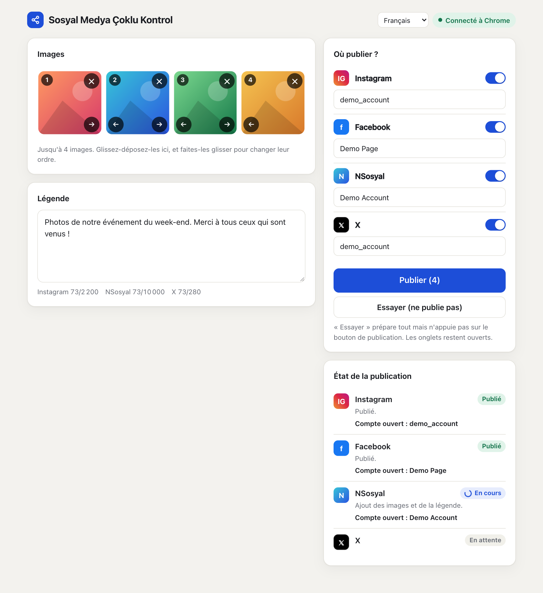
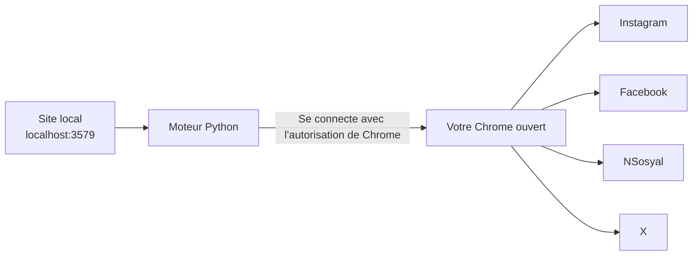

# Sosyal Medya Çoklu Kontrol

[English](../README.md) · [Türkçe](README.tr.md) · [Español](README.es.md) · [Português](README.pt.md) · **Français** · [Deutsch](README.de.md) · [Русский](README.ru.md) · [العربية](README.ar.md) · [简体中文](README.zh.md) · [日本語](README.ja.md)

Préparez vos images et votre légende sur un seul écran, puis publiez-les sur **Instagram, Facebook, NSosyal et X** en un seul clic.

Le programme s'exécute sur votre propre ordinateur et utilise le Chrome dans lequel vos comptes sont déjà connectés. Il ne demande ni ne conserve aucun mot de passe, et il n'envoie vos données à aucun autre serveur.



## Fonctionnalités

- **Un écran, quatre plateformes :** jusqu'à 4 images et une légende partent vers toutes les plateformes que vous choisissez.
- **Utilise votre propre Chrome :** il fonctionne avec vos sessions existantes et n'a besoin ni d'une autre fenêtre ni d'une nouvelle connexion.
- **Mode essai :** il prépare tout, mais n'appuie pas sur Publier. Rien n'est publié tant que vous ne l'avez pas décidé.
- **Vérification du compte :** si le compte ouvert ne correspond pas à celui que vous avez enregistré, aucune image n'est même ajoutée sur cette plateforme.
- **Protection contre les doublons :** si le résultat ne peut pas être vérifié, il ne réessaie pas automatiquement. Il vous demande de vérifier.
- **Pannes isolées :** si une plateforme échoue, les autres continuent et l'onglet en échec reste ouvert.
- **Attend si vous êtes déconnecté :** il met l'écran de connexion au premier plan et reprend dès que vous vous connectez.
- **Interface confortable :** glisser-déposer, ordre des images, compteurs de caractères, thème sombre et affichage adapté à la largeur d'un téléphone.
- **10 langues d'interface :** anglais, turc, espagnol, portugais, français, allemand, russe, arabe, chinois et japonais. Il suit la langue de votre navigateur et vous pouvez la changer depuis le menu en haut de la page.

## Installation

**Il vous faut :** [Google Chrome](https://www.google.com/chrome/) et [Python 3.10 ou plus récent](https://www.python.org/downloads/). Sous Windows, cochez **Add python.exe to PATH** pendant l'installation de Python.

1. Extrayez le dossier à un emplacement permanent, comme le Bureau. Ne le lancez pas depuis l'intérieur du zip.
2. Double-cliquez sur le lanceur :

| Système | Fichier |
|---|---|
| Windows | `baslat.bat` |
| macOS | `baslat.command` |

Le premier lancement installe le nécessaire, ce qui peut prendre une ou deux minutes et demande une connexion internet. Ensuite, le site s'ouvre directement dans Chrome.

> Si Windows affiche « Windows a protégé votre ordinateur », choisissez **Informations complémentaires → Exécuter quand même**. Si macOS le bloque, allez dans **Réglages Système → Confidentialité et sécurité → Ouvrir quand même**.

## Utilisation

### 1. Se connecter à Chrome (la première fois)

1. Ouvrez `chrome://inspect/#remote-debugging` dans Chrome.
2. Cochez **Allow remote debugging for this browser instance**.
3. Sur le site, appuyez sur **Se connecter à Chrome**, puis choisissez **Autoriser** si Chrome vous le demande.

Chrome peut redemander l'autorisation à chaque réouverture du programme.

### 2. Enregistrer vos comptes (une seule fois)

1. Connectez-vous dans Chrome avec les comptes depuis lesquels vous voulez publier.
2. Ajoutez une image et appuyez sur **Essayer**. Rien n'est publié.
3. Si le compte affiché dans la section d'état est le bon, appuyez sur **Enregistrer ce compte**.

Pour publier en tant que Page Facebook, passez d'abord à cette Page dans Chrome.

### 3. Publier

Ajoutez vos images, écrivez la légende, choisissez les plateformes, appuyez sur **Publier** et confirmez le récapitulatif. Les onglets réussis se ferment au bout de 30 secondes. Vous pouvez modifier ce délai avec la valeur `kapanmaSuresiSn` dans `data/ayarlar.json`.

### Signification des états

| État | Signification | Que faire |
|---|---|---|
| Publié | La publication a été vérifiée | Rien |
| Prêt | Le mode essai est terminé, rien n'a été publié | Vérifiez l'onglet et fermez-le sans appuyer sur Publier |
| Connexion attendue | Vous êtes déconnecté | Connectez-vous dans l'onglet ouvert |
| À vérifier | Le bouton a été actionné, mais le résultat n'a pas pu être vérifié | Regardez si la publication est apparue avant de décider quoi faire |
| Erreur | Non publié | Lisez le message. Une capture d'écran se trouve dans le dossier `data/hatalar` |

## Fonctionnement



Un nouvel onglet s'ouvre pour chaque plateforme, et ces étapes s'exécutent dans l'ordre : vérification de la session, vérification du compte, ajout des images, saisie de la légende, publication et vérification du résultat. Le programme ne touche qu'aux onglets qu'il a ouverts. À sa fermeture, il ne ferme pas Chrome, il se déconnecte simplement.

## Structure des dossiers

```text
sosyal-medya-coklu-kontrol/
├── baslat.bat            Lanceur Windows
├── baslat.command        Lanceur macOS
├── KULLANIM.txt          Courte note d'utilisation (en turc)
├── LICENSE               Licence MIT
├── requirements.txt      Dépendances Python
├── app/
│   ├── __main__.py       Point d'entrée
│   ├── server.py         Site web local
│   ├── engine.py         Moteur de publication
│   ├── platforms.py      Étapes propres à chaque plateforme
│   ├── messages.py       Messages traduisibles
│   └── static/           Interface
│       └── i18n/         Traductions de l'interface
├── scripts/              Scripts de création de paquet et de captures d'écran
├── tests/                Tests automatisés
├── docs/                 Traductions du README et captures d'écran
└── data/                 Noms des comptes, captures d'erreurs (non ajouté à git)
```

Si une plateforme modifie son interface, le fichier à corriger est `app/platforms.py`.

## Sécurité et confidentialité

- Le site n'est accessible que depuis cet ordinateur (`127.0.0.1`). Les requêtes venant d'autres sites sont rejetées.
- Les mots de passe, cookies et données de session ne sont ni lus ni conservés. Les noms de comptes sont la seule chose enregistrée.
- Tant que la case de débogage à distance de Chrome est cochée, des programmes de l'ordinateur peuvent demander l'autorisation de se connecter à Chrome. N'approuvez pas une fenêtre d'autorisation que vous n'attendiez pas. Sur un ordinateur partagé, décochez la case quand vous avez terminé.
- Les captures d'écran du dossier `data/hatalar` peuvent contenir le contenu de vos comptes. Ne les partagez qu'avec des personnes de confiance.

## Limites et risques connus

> **Important :** Ce programme utilise les interfaces web, pas les API officielles des plateformes. Les règles des plateformes peuvent restreindre ce type d'automatisation. Par exemple, les règles de X sanctionneraient, selon les informations disponibles, les actions automatisées via son site web, jusqu'à la suspension du compte. La décision de l'utiliser et la responsabilité vous incombent. Pour les comptes importants, lisez d'abord les règles.

- **Langue des sites :** le réglage de la langue de l'interface ne modifie que ce programme. Instagram et Facebook doivent être en anglais ou en turc, car leurs boutons sont repérés par leur texte. Dans une autre langue du site, le programme s'arrête avec une erreur sans rien publier. NSosyal doit être en turc. X ne dépend pas de la langue du site.
- La fenêtre noire du lanceur n'affiche ses messages qu'en turc et en anglais.
- Les traductions ont été rédigées avec une IA et n'ont pas été relues par des locuteurs natifs. Les corrections sont les bienvenues.
- Les étapes peuvent cesser de fonctionner quand les plateformes modifient leur interface.
- Il n'essaie pas de contourner les écrans de vérification ni la protection anti-bot. C'est à vous de les résoudre.
- L'ordinateur et Chrome doivent rester allumés pendant que le programme travaille.
- Les limites par image varient selon la plateforme. Les formats JPEG, PNG et WebP sont pris en charge, pas la vidéo.
- Laissez désactivée l'option « Share to → Facebook » d'Instagram, sinon la publication apparaîtra deux fois sur Facebook.

### État des tests

| Domaine | État |
|---|---|
| Tests automatisés (avec de faux sites), y compris les 10 langues d'interface | Réussis |
| Préparation, images multiples et vérification du compte sur les vrais sites (macOS, sites en turc) | Essayé en mode essai |
| Appui sur Publier sur les vrais sites | **Pas encore essayé** |
| Lecture du compte en mode Page Facebook | **Pas encore essayé** |
| Exécution sous Windows | **Pas encore essayé** |

Faites votre première vraie publication sur une seule plateforme, avec un message sans importance.

## Dépannage

| Problème | Solution |
|---|---|
| "Python 3.10 or newer was not found" | Installez Python. Sous Windows, cochez **Add python.exe to PATH** |
| « Connexion à Chrome impossible » | Vérifiez que Chrome est ouvert, que la case est cochée et que la fenêtre d'autorisation a été acceptée |
| « Le compte ouvert n'a pas pu être lu, arrêt par sécurité » | Agrandissez la fenêtre de Chrome pour que les menus latéraux des sites soient visibles |
| « Mauvais compte ouvert » | Passez au bon compte dans Chrome ou corrigez le nom du compte enregistré |
| « L'écran de publication est introuvable » | Mettez le site en anglais ou en turc. Si c'est déjà le cas, l'interface du site a peut-être changé : regardez dans le dossier `data/hatalar` |
| Port déjà utilisé | Le programme est déjà ouvert. Rendez-vous sur `http://localhost:3579` |

## Développement

```bash
python3 -m venv .venv
.venv/bin/python -m pip install -r requirements.txt
.venv/bin/python -m app
```

Les tests ne touchent ni aux vrais comptes ni à votre Chrome. Ils utilisent un Chrome distinct avec un profil temporaire et de faux sites :

```bash
.venv/bin/python -m unittest tests.test_end_to_end
```

La création du paquet écrit son résultat dans le dossier `dist/` :

```bash
.venv/bin/python scripts/paketle.py
```

Pour ajouter une langue, placez son fichier dans `app/static/i18n/` et ajoutez son nom à `LANGUAGES` dans `app/static/index.html`. Les tests vérifient que toutes les langues ont les mêmes clés.

## Licence

[MIT](../LICENSE). Le logiciel est fourni sans aucune garantie.
