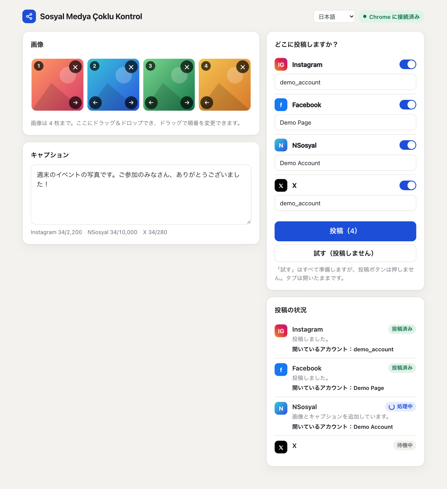
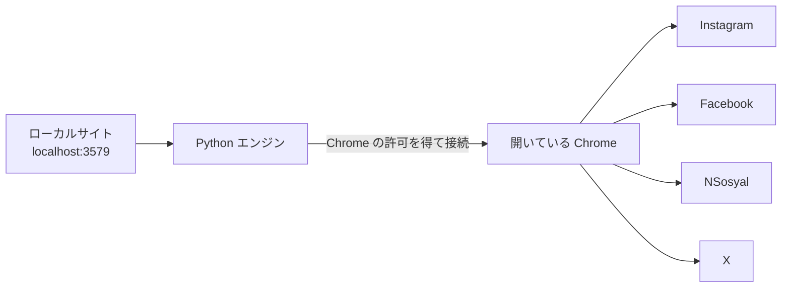

# Sosyal Medya Çoklu Kontrol

[English](../README.md) · [Türkçe](README.tr.md) · [Español](README.es.md) · [Português](README.pt.md) · [Français](README.fr.md) · [Deutsch](README.de.md) · [Русский](README.ru.md) · [العربية](README.ar.md) · [简体中文](README.zh.md) · **日本語**

画像とキャプションを1つの画面で準備して、**Instagram、Facebook、NSosyal、X** にボタン1つで投稿できます。

このプログラムはあなた自身のコンピューターで動き、すでにアカウントにログインしている Chrome を使います。パスワードを尋ねたり保存したりすることはなく、データを他のサーバーに送ることもありません。



## 特長

- **1つの画面で4つのプラットフォーム：** 最大4枚の画像と1つのキャプションを、選んだすべてのプラットフォームに送ります。
- **自分の Chrome を使います：** 既存のログイン状態のまま動くので、別のウィンドウも再ログインも必要ありません。
- **試すモード：** すべてを準備しますが、投稿ボタンは押しません。あなたが決めるまで何も公開されません。
- **アカウントの確認：** 開いているアカウントが保存したものと一致しない場合、そのプラットフォームでは画像すら追加されません。
- **二重投稿の防止：** 結果を確認できなかった場合は自動で再試行せず、あなたに確認を促します。
- **エラーの切り分け：** 1つのプラットフォームが失敗しても他は続行し、失敗したタブは開いたままになります。
- **ログアウトしたら待機：** ログイン画面を前面に出し、ログインすると続きから再開します。
- **使いやすいインターフェース：** ドラッグ＆ドロップ、画像の並べ替え、文字数カウンター、ダークテーマ、スマートフォンの幅への対応があります。
- **10のインターフェース言語：** 英語、トルコ語、スペイン語、ポルトガル語、フランス語、ドイツ語、ロシア語、アラビア語、中国語、日本語に対応しています。ブラウザーの言語に合わせて表示され、ページ上部のメニューから変更できます。

## インストール

**必要なもの：** [Google Chrome](https://www.google.com/chrome/) と [Python 3.10 以降](https://www.python.org/downloads/)。Windows では、Python のインストール時に **Add python.exe to PATH** にチェックを入れてください。

1. フォルダーをデスクトップなど、常に置いておける場所に展開します。zip の中から直接実行しないでください。
2. ランチャーをダブルクリックします。

| システム | ファイル |
|---|---|
| Windows | `baslat.bat` |
| macOS | `baslat.command` |

初回の起動では必要なものがインストールされます。1～2分ほどかかることがあり、インターネット接続が必要です。2回目以降は、サイトが直接 Chrome で開きます。

> Windows に「Windows によって PC が保護されました」と表示されたら、**詳細情報 → 実行** を選んでください。macOS にブロックされた場合は、**システム設定 → プライバシーとセキュリティ → このまま開く** を選びます。

## 使い方

### 1. Chrome に接続する（初回）

1. Chrome で `chrome://inspect/#remote-debugging` を開きます。
2. **Allow remote debugging for this browser instance** にチェックを入れます。
3. サイトで **Chrome に接続** を押し、Chrome から確認されたら **許可** を選びます。

プログラムを開き直すたびに、Chrome が再び許可を求めることがあります。

### 2. アカウントを保存する（1回だけ）

1. 投稿に使いたいアカウントで、Chrome からログインします。
2. 画像を追加して **試す** を押します。何も投稿されません。
3. ステータス欄に表示されたアカウントが正しければ、**このアカウントを保存** を押します。

Facebook のページとして投稿する場合は、先に Chrome でそのページに切り替えてください。

### 3. 投稿する

画像を追加し、キャプションを書き、プラットフォームを選んで **投稿** を押し、概要を確認します。成功したタブは30秒後に閉じます。この時間は `data/ayarlar.json` の `kapanmaSuresiSn` の値で変更できます。

### ステータスの意味

| ステータス | 意味 | すること |
|---|---|---|
| 投稿済み | 投稿を確認できました | 何もしなくて大丈夫です |
| 準備完了 | 試すモードが終わりました。何も投稿されていません | タブを確認し、投稿を押さずに閉じます |
| ログイン待ち | ログアウトしています | 開いたタブでログインします |
| 要確認 | ボタンは押されましたが、結果を確認できませんでした | 投稿が表示されているかを見てから、どうするか決めます |
| エラー | 投稿されませんでした | メッセージを読んでください。スクリーンショットは `data/hatalar` フォルダーにあります |

## 仕組み



プラットフォームごとに新しいタブが開き、次の手順が順番に実行されます。ログインの確認、アカウントの確認、画像の追加、キャプションの入力、投稿、結果の確認です。プログラムは自分が開いたタブにしか触れません。終了するときも Chrome は閉じず、接続を切るだけです。

## フォルダー構成

```text
sosyal-medya-coklu-kontrol/
├── baslat.bat            Windows 用ランチャー
├── baslat.command        macOS 用ランチャー
├── KULLANIM.txt          簡単な使い方メモ（トルコ語）
├── LICENSE               MIT ライセンス
├── requirements.txt      Python の依存パッケージ
├── app/
│   ├── __main__.py       エントリーポイント
│   ├── server.py         ローカル Web サイト
│   ├── engine.py         投稿エンジン
│   ├── platforms.py      プラットフォーム別の手順
│   ├── messages.py       翻訳可能なメッセージ
│   └── static/           インターフェース
│       └── i18n/         インターフェースの翻訳
├── scripts/              パッケージ化とスクリーンショット用のスクリプト
├── tests/                自動テスト
├── docs/                 README の翻訳とスクリーンショット
└── data/                 アカウント名、エラーのスクリーンショット（git には含まれません）
```

プラットフォームがインターフェースを変更した場合は、`app/platforms.py` を修正します。

## セキュリティとプライバシー

- サイトにはこのコンピューターからしかアクセスできません（`127.0.0.1`）。他のサイトからのリクエストは拒否されます。
- パスワード、Cookie、セッション情報は読み取りも保存もされません。保存されるのはアカウント名だけです。
- Chrome のリモートデバッグのチェックを入れている間は、コンピューター上のプログラムが Chrome に接続する許可を求めてくることがあります。想定していない許可ウィンドウは承認しないでください。共有のコンピューターでは、使い終わったらチェックを外してください。
- `data/hatalar` フォルダーのスクリーンショットには、アカウントの内容が写っていることがあります。信頼できる人にだけ共有してください。

## 既知の制限とリスク

> **重要：** このプログラムは、各プラットフォームの公式 API ではなく Web インターフェースを使います。プラットフォームの規約が、この種の自動化を制限している場合があります。たとえば X の規約は、サイト経由の自動操作に対して、アカウント停止にいたる措置をとるとされています。使うかどうかの判断と責任はあなたにあります。重要なアカウントでは、先に規約を確認してください。

- **サイトの言語：** インターフェース言語の設定で変わるのは、このプログラムだけです。Instagram と Facebook は、ボタンを文字で見つけているため、英語またはトルコ語に設定する必要があります。それ以外のサイト言語では、プログラムは何も投稿せずにエラーで止まります。NSosyal はトルコ語であることが前提です。X はサイトの言語に依存しません。
- ランチャーの黒いウィンドウは、メッセージをトルコ語と英語でしか表示しません。
- 翻訳は AI が書いたもので、ネイティブスピーカーによる確認は受けていません。修正は歓迎します。
- プラットフォームがインターフェースを変更すると、該当する手順が動かなくなることがあります。
- 認証画面やボット対策を突破しようとはしません。それらはご自身で解決する必要があります。
- プログラムの動作中は、コンピューターと Chrome を起動したままにしてください。
- 画像1枚あたりの制限はプラットフォームによって異なります。JPEG、PNG、WebP に対応しており、動画には対応していません。
- Instagram の “Share to → Facebook” オプションはオフのままにしてください。そうしないと、Facebook に同じ投稿が2回表示されます。

### テストの状況

| 項目 | 状況 |
|---|---|
| 自動テスト（模擬サイトを使用）。10のインターフェース言語すべてを含む | 合格 |
| 実際のサイトでの準備、複数画像、アカウントの確認（macOS、トルコ語のサイト） | 試すモードで確認済み |
| 実際のサイトで投稿ボタンを押す | **まだ試していません** |
| Facebook ページモードでのアカウントの読み取り | **まだ試していません** |
| Windows での実行 | **まだ試していません** |

最初の本番の投稿は、1つのプラットフォームで、重要でない投稿を使って行ってください。

## トラブルシューティング

| 問題 | 対処 |
|---|---|
| "Python 3.10 or newer was not found" | Python をインストールします。Windows では **Add python.exe to PATH** にチェックを入れてください |
| 「Chrome に接続できませんでした」 | Chrome が開いているか、チェックが入っているか、許可のウィンドウを承認したかを確認します |
| 「開いているアカウントを読み取れないため、安全のため停止しました」 | Chrome のウィンドウを広げて、サイトのサイドメニューが見えるようにします |
| 「別のアカウントが開いています」 | Chrome で正しいアカウントに切り替えるか、保存したアカウント名を修正します |
| 「投稿画面が見つかりません」 | サイトの言語を英語またはトルコ語にします。すでにそうなっている場合は、サイトのインターフェースが変わった可能性があります。`data/hatalar` フォルダーを確認してください |
| ポートがすでに使われている | プログラムはすでに開いています。`http://localhost:3579` にアクセスしてください |

## 開発

```bash
python3 -m venv .venv
.venv/bin/python -m pip install -r requirements.txt
.venv/bin/python -m app
```

テストは実際のアカウントやあなたの Chrome には触れません。一時プロファイルを使う別の Chrome と、模擬サイトを使います。

```bash
.venv/bin/python -m unittest tests.test_end_to_end
```

パッケージ化の出力は `dist/` フォルダーに書き込まれます。

```bash
.venv/bin/python scripts/paketle.py
```

言語を追加するには、そのファイルを `app/static/i18n/` に追加し、名前を `app/static/index.html` の `LANGUAGES` に追加します。テストでは、すべての言語に同じキーがあるかを確認します。

## ライセンス

[MIT](../LICENSE)。このソフトウェアは、いかなる保証もなく提供されます。
