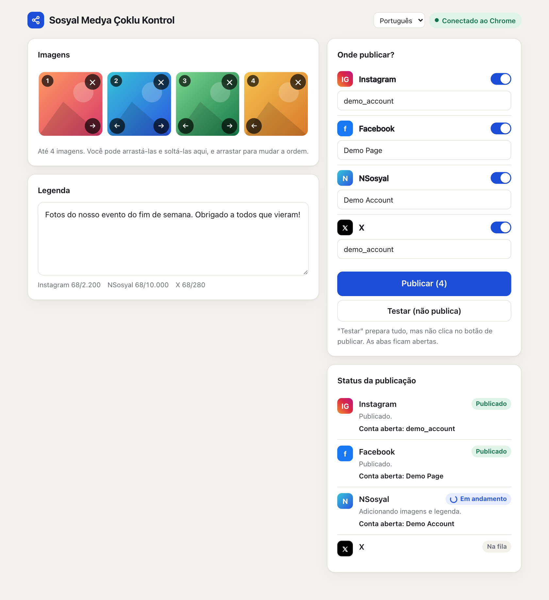
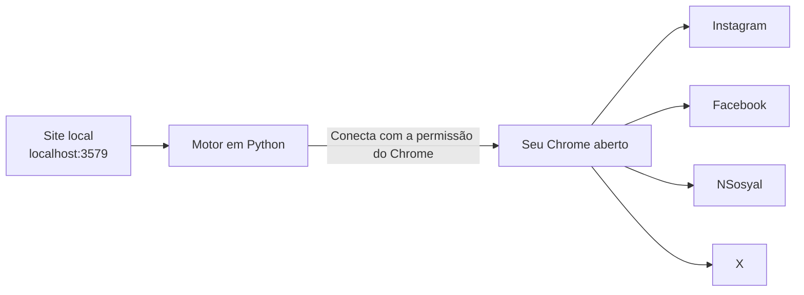

# Sosyal Medya Çoklu Kontrol

[English](../README.md) · [Türkçe](README.tr.md) · [Español](README.es.md) · **Português** · [Français](README.fr.md) · [Deutsch](README.de.md) · [Русский](README.ru.md) · [العربية](README.ar.md) · [简体中文](README.zh.md) · [日本語](README.ja.md)

Prepare suas imagens e a legenda em uma única tela e publique no **Instagram, Facebook, NSosyal e X** com um só botão.

O programa roda no seu próprio computador e usa o Chrome em que suas contas já estão conectadas. Ele não pede nem guarda senhas e não envia seus dados a nenhum outro servidor.



## Recursos

- **Uma tela, quatro plataformas:** até 4 imagens e uma legenda vão para todas as plataformas que você escolher.
- **Usa o seu próprio Chrome:** funciona com as suas sessões atuais e não precisa de outra janela nem de um novo login.
- **Modo de teste:** prepara tudo, mas não aperta Publicar. Nada é publicado até você decidir.
- **Verificação de conta:** se a conta aberta não for a que você salvou, nem uma imagem é adicionada nessa plataforma.
- **Proteção contra publicação duplicada:** se o resultado não puder ser verificado, ele não tenta de novo automaticamente. Avisa para você conferir.
- **Falhas isoladas:** se uma plataforma falhar, as outras continuam e a aba com problema permanece aberta.
- **Espera se a sessão cair:** traz a tela de login para a frente e continua assim que você entrar.
- **Interface confortável:** arrastar e soltar, ordenação de imagens, contadores de caracteres, tema escuro e layout adaptado à largura do celular.
- **10 idiomas de interface:** inglês, turco, espanhol, português, francês, alemão, russo, árabe, chinês e japonês. Segue o idioma do seu navegador e pode ser alterado pelo menu no topo da página.

## Instalação

**Você precisa de:** [Google Chrome](https://www.google.com/chrome/) e [Python 3.10 ou mais recente](https://www.python.org/downloads/). No Windows, marque **Add python.exe to PATH** ao instalar o Python.

1. Extraia a pasta em um local permanente, como a Área de Trabalho. Não execute de dentro do zip.
2. Dê um duplo clique no inicializador:

| Sistema | Arquivo |
|---|---|
| Windows | `baslat.bat` |
| macOS | `baslat.command` |

Na primeira execução, o que for necessário é instalado, o que pode levar um ou dois minutos e exige internet. Depois disso, o site abre direto no Chrome.

> Se o Windows exibir "O Windows protegeu o computador", escolha **Mais informações → Executar assim mesmo**. Se o macOS bloquear, vá em **Ajustes do Sistema → Privacidade e Segurança → Abrir Mesmo Assim**.

## Como usar

### 1. Conectar ao Chrome (na primeira vez)

1. Abra `chrome://inspect/#remote-debugging` no Chrome.
2. Marque **Allow remote debugging for this browser instance**.
3. No site, clique em **Conectar ao Chrome** e escolha **Permitir** se o Chrome perguntar.

O Chrome pode pedir permissão novamente a cada vez que o programa for reaberto.

### 2. Salvar suas contas (uma vez)

1. Entre pelo Chrome com as contas das quais você quer publicar.
2. Adicione uma imagem e clique em **Testar**. Nada é publicado.
3. Se a conta mostrada na seção de status estiver certa, clique em **Salvar esta conta**.

Para publicar como Página do Facebook, mude primeiro para essa Página no Chrome.

### 3. Publicar

Adicione as imagens, escreva a legenda, escolha as plataformas, clique em **Publicar** e confirme o resumo. As abas que deram certo se fecham após 30 segundos. Você pode mudar isso no valor `kapanmaSuresiSn` em `data/ayarlar.json`.

### O que significa cada status

| Status | Significado | O que fazer |
|---|---|---|
| Publicado | A publicação foi verificada | Nada |
| Pronto | O modo de teste terminou, nada foi publicado | Confira a aba e feche-a sem clicar em Publicar |
| Aguardando login | Você está desconectado | Entre na aba que foi aberta |
| Verificar | O botão foi acionado, mas o resultado não pôde ser verificado | Veja se a publicação apareceu antes de decidir o que fazer |
| Erro | Não foi publicado | Leia a mensagem. Há uma captura de tela na pasta `data/hatalar` |

## Como funciona



Uma nova aba é aberta para cada plataforma e estas etapas rodam em ordem: verificação da sessão, verificação da conta, adição das imagens, digitação da legenda, publicação e verificação do resultado. O programa só mexe nas abas que ele mesmo abriu. Ao encerrar, ele não fecha o Chrome, apenas se desconecta.

## Estrutura de pastas

```text
sosyal-medya-coklu-kontrol/
├── baslat.bat            Inicializador para Windows
├── baslat.command        Inicializador para macOS
├── KULLANIM.txt          Nota curta de uso (em turco)
├── LICENSE               Licença MIT
├── requirements.txt      Dependências do Python
├── app/
│   ├── __main__.py       Ponto de entrada
│   ├── server.py         Site local
│   ├── engine.py         Motor de publicação
│   ├── platforms.py      Etapas específicas de cada plataforma
│   ├── messages.py       Mensagens traduzíveis
│   └── static/           Interface
│       └── i18n/         Traduções da interface
├── scripts/              Scripts de empacotamento e de capturas de tela
├── tests/                Testes automatizados
├── docs/                 Traduções do README e capturas de tela
└── data/                 Nomes das contas, capturas de erros (não vai para o git)
```

Se uma plataforma mudar a interface, o arquivo a corrigir é `app/platforms.py`.

## Segurança e privacidade

- O site só pode ser acessado a partir deste computador (`127.0.0.1`). Requisições vindas de outros sites são rejeitadas.
- Senhas, cookies e dados de sessão não são lidos nem armazenados. A única coisa salva são os nomes das contas.
- Enquanto a caixa de depuração remota do Chrome estiver marcada, programas do computador podem pedir permissão para se conectar ao Chrome. Não aprove uma janela de permissão que você não esperava. Em um computador compartilhado, desmarque a caixa quando terminar.
- As capturas de tela da pasta `data/hatalar` podem conter conteúdo das suas contas. Compartilhe-as apenas com pessoas de confiança.

## Limites e riscos conhecidos

> **Importante:** Este programa usa as interfaces web, não as APIs oficiais das plataformas. As regras das plataformas podem restringir esse tipo de automação. Por exemplo, há relatos de que as regras do X punem ações automatizadas pelo site, até a suspensão da conta. A decisão de usar e a responsabilidade são suas. Em contas importantes, leia as regras antes.

- **Idioma dos sites:** a configuração de idioma da interface muda apenas este programa. O Instagram e o Facebook precisam estar em inglês ou turco, porque seus botões são encontrados pelo texto. Em outros idiomas do site, o programa para com um erro sem publicar nada. Espera-se que o NSosyal esteja em turco. O X não depende do idioma do site.
- A janela preta do inicializador mostra suas mensagens apenas em turco e inglês.
- As traduções foram escritas com IA e não foram revisadas por falantes nativos. Correções são bem-vindas.
- As etapas podem parar de funcionar quando as plataformas mudarem suas interfaces.
- Ele não tenta contornar telas de verificação nem proteção contra bots. Você precisa resolvê-las por conta própria.
- O computador e o Chrome precisam continuar ligados enquanto o programa estiver trabalhando.
- Os limites por imagem variam conforme a plataforma. JPEG, PNG e WebP são aceitos; vídeo não.
- Mantenha desativada a opção "Share to → Facebook" do Instagram, ou a publicação aparecerá duas vezes no Facebook.

### Situação dos testes

| Área | Situação |
|---|---|
| Testes automatizados (com sites falsos), incluindo os 10 idiomas de interface | Passando |
| Preparação, várias imagens e verificação de conta nos sites reais (macOS, sites em turco) | Testado no modo de teste |
| Clicar em Publicar nos sites reais | **Ainda não testado** |
| Leitura da conta no modo Página do Facebook | **Ainda não testado** |
| Execução no Windows | **Ainda não testado** |

Faça sua primeira publicação real em uma única plataforma, com uma postagem sem importância.

## Solução de problemas

| Problema | Solução |
|---|---|
| "Python 3.10 or newer was not found" | Instale o Python. No Windows, marque **Add python.exe to PATH** |
| "Não foi possível conectar ao Chrome" | Verifique se o Chrome está aberto, se a caixa está marcada e se a janela de permissão foi aprovada |
| "Não foi possível ler a conta aberta; interrompido por segurança" | Aumente a janela do Chrome para que os menus laterais dos sites fiquem visíveis |
| "A conta aberta está errada" | Troque para a conta certa no Chrome ou corrija o nome da conta salva |
| "A tela de publicação não foi encontrada" | Defina o idioma do site como inglês ou turco. Se já estiver, a interface do site pode ter mudado: veja a pasta `data/hatalar` |
| Porta já em uso | O programa já está aberto. Acesse `http://localhost:3579` |

## Desenvolvimento

```bash
python3 -m venv .venv
.venv/bin/python -m pip install -r requirements.txt
.venv/bin/python -m app
```

Os testes não tocam em contas reais nem no seu Chrome. Eles usam um Chrome separado, com perfil temporário, e sites falsos:

```bash
.venv/bin/python -m unittest tests.test_end_to_end
```

O empacotamento grava sua saída na pasta `dist/`:

```bash
.venv/bin/python scripts/paketle.py
```

Para adicionar um idioma, coloque o arquivo dele em `app/static/i18n/` e o nome em `LANGUAGES` em `app/static/index.html`. Os testes verificam se todos os idiomas têm as mesmas chaves.

## Licença

[MIT](../LICENSE). O software é fornecido sem nenhuma garantia.
