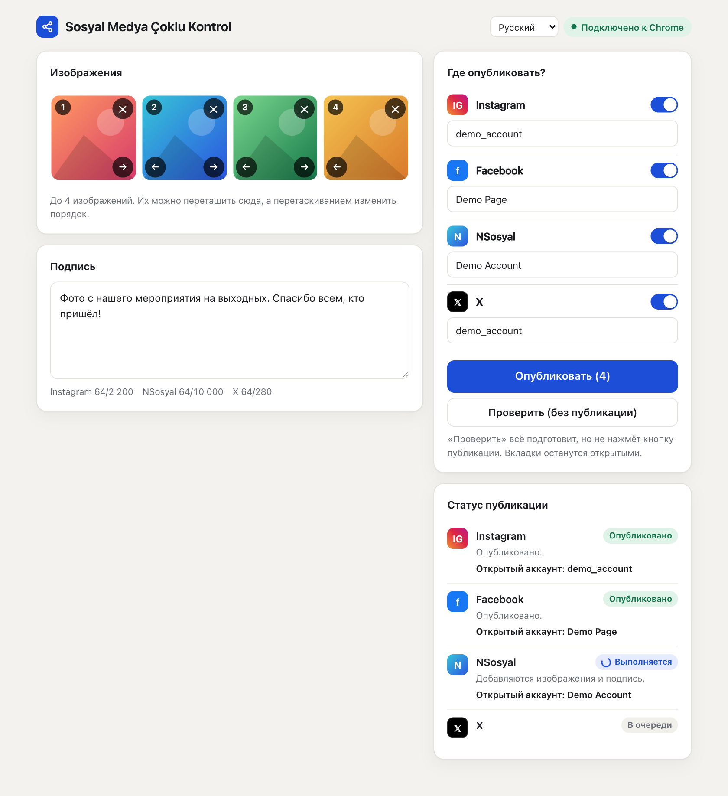
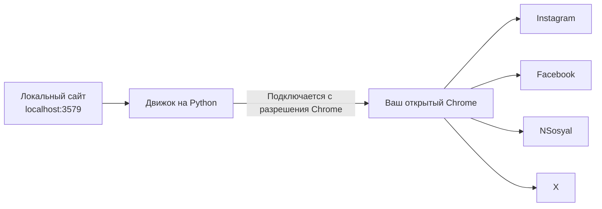

# Sosyal Medya Çoklu Kontrol

[English](../README.md) · [Türkçe](README.tr.md) · [Español](README.es.md) · [Português](README.pt.md) · [Français](README.fr.md) · [Deutsch](README.de.md) · **Русский** · [العربية](README.ar.md) · [简体中文](README.zh.md) · [日本語](README.ja.md)

Подготовьте изображения и подпись на одном экране и опубликуйте их в **Instagram, Facebook, NSosyal и X** одной кнопкой.

Программа работает на вашем компьютере и использует Chrome, в котором вы уже вошли в свои аккаунты. Она не запрашивает и не хранит пароли и не отправляет ваши данные на другие серверы.



## Возможности

- **Один экран, четыре платформы:** до 4 изображений и одна подпись отправляются на все выбранные вами платформы.
- **Использует ваш Chrome:** работает с вашими текущими сеансами, не требует отдельного окна или нового входа.
- **Режим проверки:** подготавливает всё, но не нажимает «Опубликовать». Ничего не публикуется, пока вы не решите.
- **Проверка аккаунта:** если открытый аккаунт не совпадает с сохранённым, на этой платформе не будет добавлено даже изображение.
- **Защита от дублей:** если результат не удаётся подтвердить, программа не повторяет попытку автоматически, а просит вас проверить.
- **Изоляция сбоев:** если одна платформа завершилась ошибкой, остальные продолжают работу, а вкладка с проблемой остаётся открытой.
- **Ждёт, если вы вышли из аккаунта:** выводит страницу входа на передний план и продолжает работу, когда вы войдёте.
- **Удобный интерфейс:** перетаскивание, порядок изображений, счётчики символов, тёмная тема и раскладка для узких экранов телефона.
- **10 языков интерфейса:** английский, турецкий, испанский, португальский, французский, немецкий, русский, арабский, китайский и японский. Язык выбирается по языку браузера, его можно сменить в меню в верхней части страницы.

## Установка

**Вам понадобятся:** [Google Chrome](https://www.google.com/chrome/) и [Python 3.10 или новее](https://www.python.org/downloads/). В Windows при установке Python отметьте **Add python.exe to PATH**.

1. Распакуйте папку в постоянное место, например на рабочий стол. Не запускайте программу из архива.
2. Дважды щёлкните по запускающему файлу:

| Система | Файл |
|---|---|
| Windows | `baslat.bat` |
| macOS | `baslat.command` |

При первом запуске устанавливается всё необходимое: это может занять минуту-две и требует интернета. В дальнейшем сайт открывается сразу в Chrome.

> Если Windows показывает сообщение «Windows защитила ваш компьютер», выберите **Подробнее → Выполнить в любом случае**. Если macOS блокирует запуск, откройте **Системные настройки → Конфиденциальность и безопасность → Всё равно открыть**.

## Использование

### 1. Подключение к Chrome (в первый раз)

1. Откройте в Chrome адрес `chrome://inspect/#remote-debugging`.
2. Отметьте **Allow remote debugging for this browser instance**.
3. На сайте нажмите **Подключиться к Chrome** и выберите **Разрешить**, если Chrome запросит разрешение.

Chrome может запрашивать разрешение заново при каждом повторном запуске программы.

### 2. Сохранение аккаунтов (один раз)

1. Войдите в Chrome в те аккаунты, от имени которых хотите публиковать.
2. Добавьте изображение и нажмите **Проверить**. Ничего не публикуется.
3. Если аккаунт, показанный в разделе статуса, верный, нажмите **Сохранить этот аккаунт**.

Сохранённое имя должно совпадать с тем, что показывает сайт. Instagram и X используют имя пользователя. Facebook и NSosyal используют отображаемое имя, например полное название страницы. Если имена различаются, программа останавливается на этой платформе без публикации. Кнопка **Сохранить этот аккаунт** подставит правильное имя за вас.

Чтобы публиковать от имени страницы Facebook, сначала переключитесь на эту страницу в Chrome.

### 3. Публикация

Добавьте изображения, напишите подпись, выберите платформы, нажмите **Опубликовать** и подтвердите сводку. Успешные вкладки закрываются через 30 секунд. Это значение можно изменить в параметре `kapanmaSuresiSn` файла `data/ayarlar.json`.

### Что означают статусы

| Статус | Значение | Что делать |
|---|---|---|
| Опубликовано | Публикация подтверждена | Ничего |
| Готово | Режим проверки завершён, ничего не опубликовано | Посмотрите вкладку и закройте её, не нажимая «Опубликовать» |
| Ожидание входа | Вы вышли из аккаунта | Войдите на открывшейся вкладке |
| Проверьте | Кнопка нажата, но результат подтвердить не удалось | Посмотрите, появилась ли публикация, и только потом решайте, что делать |
| Ошибка | Не опубликовано | Прочитайте сообщение. Снимок экрана лежит в папке `data/hatalar` |

## Как это работает



Для каждой платформы открывается новая вкладка, и по порядку выполняются такие шаги: проверка сеанса, проверка аккаунта, добавление изображений, ввод подписи, публикация и проверка результата. Программа трогает только вкладки, которые открыла сама. При завершении она не закрывает Chrome, а только отключается от него.

## Структура папок

```text
sosyal-medya-coklu-kontrol/
├── baslat.bat            Запуск для Windows
├── baslat.command        Запуск для macOS
├── KULLANIM.txt          Краткая памятка (на турецком)
├── LICENSE               Лицензия MIT
├── requirements.txt      Зависимости Python
├── app/
│   ├── __main__.py       Точка входа
│   ├── server.py         Локальный сайт
│   ├── engine.py         Движок публикации
│   ├── platforms.py      Шаги для каждой платформы
│   ├── messages.py       Переводимые сообщения
│   └── static/           Интерфейс
│       └── i18n/         Переводы интерфейса
├── scripts/              Скрипты упаковки и снимков экрана
├── tests/                Автоматические тесты
├── docs/                 Переводы README и снимки экрана
└── data/                 Имена аккаунтов, снимки ошибок (не попадает в git)
```

Если платформа меняет свой интерфейс, исправлять нужно файл `app/platforms.py`.

## Безопасность и конфиденциальность

- Сайт доступен только с этого компьютера (`127.0.0.1`). Запросы с других сайтов отклоняются.
- Пароли, файлы cookie и данные сеансов не считываются и не сохраняются. Программа сохраняет только имена аккаунтов и записи об ошибках в `data/hatalar`.
- Пока в Chrome отмечен флажок удалённой отладки, программы на компьютере могут запрашивать разрешение на подключение к Chrome. Не подтверждайте окно с запросом разрешения, которого вы не ждали. На общем компьютере снимайте флажок, когда закончите.
- Снимки экрана и журнал `kayit.txt` в папке `data/hatalar` могут содержать имена аккаунтов и их содержимое. Передавайте их только тем, кому доверяете.

## Известные ограничения и риски

> **Важно:** эта программа использует веб-интерфейсы, а не официальные API платформ. Правила платформ могут ограничивать такую автоматизацию. Например, сообщается, что правила X предусматривают санкции за автоматические действия через сайт вплоть до блокировки аккаунта. Решение об использовании и ответственность лежат на вас. Для важных аккаунтов сначала изучите правила.

- **Язык сайтов:** настройка языка интерфейса меняет только эту программу. Для Instagram и Facebook должен быть выбран английский или турецкий язык, потому что их кнопки находятся по тексту. При другом языке сайта программа останавливается с ошибкой, ничего не опубликовав. NSosyal должен быть на турецком. X не зависит от языка сайта.
- Чёрное окно запускающего файла показывает сообщения только на турецком и английском.
- Переводы написаны с помощью ИИ и не проверялись носителями языка. Исправления приветствуются.
- Шаги могут перестать работать, когда платформы меняют свой интерфейс.
- Программа не пытается обойти экраны проверки или защиту от ботов. Их нужно проходить самостоятельно.
- Пока программа работает, компьютер и Chrome должны оставаться включёнными.
- Ограничения на одно изображение зависят от платформы. Поддерживаются JPEG, PNG и WebP, видео не поддерживается.
- Держите в Instagram параметр «Share to → Facebook» выключенным, иначе публикация появится на Facebook дважды.
- Если публикация не удалась на некоторых платформах, отключите те, где она уже прошла, прежде чем снова нажимать **Опубликовать**, иначе запись появится на них дважды.

### Состояние тестирования

| Область | Состояние |
|---|---|
| Автоматические тесты (с поддельными сайтами), включая все 10 языков интерфейса | Проходят |
| Подготовка, несколько изображений и проверка аккаунта на настоящих сайтах (macOS, сайты на турецком) | Опробовано в режиме проверки |
| Нажатие «Опубликовать» на настоящих сайтах | Сработало в одной реальной проверке в Windows |
| Чтение аккаунта в режиме страницы Facebook | **Ещё не опробовано** |
| Запуск в Windows | Сработало в одной реальной проверке |

Первую настоящую публикацию сделайте на одной платформе и с неважной записью.

## Устранение неполадок

| Проблема | Решение |
|---|---|
| "Python 3.10 or newer was not found" | Установите Python. В Windows отметьте **Add python.exe to PATH** |
| «Не удалось подключиться к Chrome» | Проверьте, что Chrome открыт, флажок отмечен, а окно с запросом разрешения подтверждено |
| «Не удалось прочитать открытый аккаунт, остановлено для безопасности» | Увеличьте окно Chrome, чтобы боковые меню сайтов были видны |
| «Открыт неверный аккаунт» | Переключитесь в Chrome на нужный аккаунт или исправьте сохранённое имя аккаунта |
| «Экран публикации не найден» | Установите на сайте английский или турецкий язык. Если он уже стоит, интерфейс сайта, возможно, изменился: загляните в папку `data/hatalar` |
| Порт уже занят | Программа уже открыта. Перейдите на `http://localhost:3579` |

## Разработка

```bash
python3 -m venv .venv
.venv/bin/python -m pip install -r requirements.txt
.venv/bin/python -m app
```

Тесты не затрагивают настоящие аккаунты и ваш Chrome. Они используют отдельный Chrome с временным профилем и поддельные сайты:

```bash
.venv/bin/python -m unittest tests.test_end_to_end
```

Упаковка записывает результат в папку `dist/`:

```bash
.venv/bin/python scripts/paketle.py
```

Чтобы добавить язык, положите его файл в `app/static/i18n/` и добавьте его название в `LANGUAGES` в `app/static/index.html`. Тесты проверяют, что во всех языках одинаковые ключи.

## Лицензия

[MIT](../LICENSE). Программа предоставляется без каких-либо гарантий.
