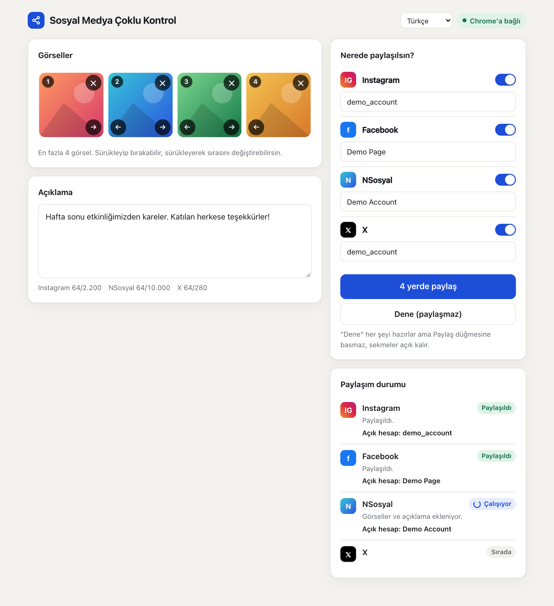
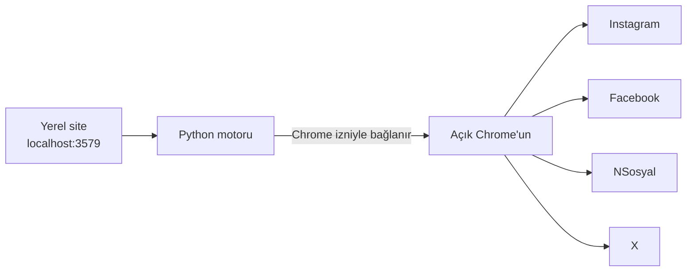

# Sosyal Medya Çoklu Kontrol

[English](../README.md) · **Türkçe** · [Español](README.es.md) · [Português](README.pt.md) · [Français](README.fr.md) · [Deutsch](README.de.md) · [Русский](README.ru.md) · [العربية](README.ar.md) · [简体中文](README.zh.md) · [日本語](README.ja.md)

Görselleri ve açıklamayı tek ekrandan hazırla; **Instagram, Facebook, NSosyal ve X**'te tek tuşla paylaş.

Program kendi bilgisayarında çalışır ve hesaplarının zaten açık olduğu Chrome'u kullanır. Şifre sormaz, şifre saklamaz, verilerini başka bir sunucuya göndermez.



## Özellikler

- **Tek ekran, dört platform:** En fazla 4 görsel ve bir açıklama, seçtiğin platformların hepsine gider.
- **Kendi Chrome'unu kullanır:** Mevcut oturumlarınla çalışır, ayrı pencere veya yeniden giriş istemez.
- **Dene modu:** Her şeyi hazırlar ama Paylaş düğmesine basmaz. Sonucu görmeden hiçbir şey yayınlanmaz.
- **Hesap kontrolü:** Açık hesap kaydettiğin hesapla eşleşmezse o platformda görsel bile eklenmez.
- **Çift gönderi koruması:** Sonuç doğrulanamazsa otomatik tekrar denemez, seni kontrol etmen için uyarır.
- **Hata izolasyonu:** Bir platform başarısız olursa diğerleri devam eder, sorunlu sekme açık kalır.
- **Oturum düşerse bekler:** Giriş ekranını öne getirir, sen giriş yapınca kaldığı yerden sürer.
- **Rahat arayüz:** Sürükle-bırak, görsel sıralama, karakter sayacı, koyu tema, telefon genişliğine uyum.
- **10 arayüz dili:** İngilizce, Türkçe, İspanyolca, Portekizce, Fransızca, Almanca, Rusça, Arapça, Çince ve Japonca. Tarayıcının dilini izler, sayfanın üstündeki menüden değiştirilebilir.

## Kurulum

**Gerekenler:** [Google Chrome](https://www.google.com/chrome/) ve [Python 3.10 veya üstü](https://www.python.org/downloads/). Windows'ta Python'u kurarken **Add python.exe to PATH** kutusunu işaretle.

1. Klasörü Masaüstü gibi kalıcı bir yere çıkar. Zip'in içinden çalıştırma.
2. Başlatıcıya çift tıkla:

| Sistem | Dosya |
|---|---|
| Windows | `baslat.bat` |
| macOS | `baslat.command` |

İlk açılışta gerekli parçalar yüklenir, bu bir iki dakika sürebilir ve internet gerekir. Sonraki açılışlarda site doğrudan Chrome'da açılır.

> Windows "bilgisayarınızı korudu" uyarısı gösterirse **Ek bilgi → Yine de çalıştır** de. macOS engellerse **Sistem Ayarları → Gizlilik ve Güvenlik → Yine de Aç** yolunu izle.

## Kullanım

### 1. Chrome'a bağlan (ilk seferde)

1. Chrome'da `chrome://inspect/#remote-debugging` adresini aç.
2. **Allow remote debugging for this browser instance** kutusunu işaretle.
3. Sitede **Chrome'a bağlan** düğmesine bas ve Chrome izin sorarsa **İzin ver** de.

Program her yeniden açıldığında Chrome izni tekrar sorabilir.

### 2. Hesapları kaydet (bir kez)

1. Paylaşım yapılacak hesaplarla Chrome'dan giriş yap.
2. Bir görsel ekleyip **Dene**'ye bas. Hiçbir şey paylaşılmaz.
3. Durum bölümünde görünen hesap doğruysa **Bu hesabı kaydet**'e bas.

Kaydedilen ad sitede görünenle aynı olmalı. Instagram ve X kullanıcı adını kullanır. Facebook ve NSosyal ise görünen adı, örneğin Sayfa'nın tam adını kullanır. Adlar farklıysa program o platformda paylaşmadan durur. **Bu hesabı kaydet** doğru adı senin yerine yazar.

Facebook'ta bir Sayfa adına paylaşacaksan önce Chrome'da o Sayfa'ya geç.

### 3. Paylaş

Görselleri ekle, açıklamayı yaz, platformları seç, **Paylaş**'a bas ve özeti onayla. Başarılı sekmeler 30 saniye sonra kapanır. Bu süre `data/ayarlar.json` dosyasındaki `kapanmaSuresiSn` değerinden değiştirilebilir.

### Durumların anlamı

| Durum | Anlamı | Ne yapmalı? |
|---|---|---|
| Paylaşıldı | Gönderi doğrulandı | Bir şey yapma |
| Hazır | Dene modu tamamlandı, paylaşılmadı | Sekmeyi kontrol edip Paylaş'a basmadan kapat |
| Giriş bekleniyor | Oturum kapalı | Açılan sekmede giriş yap |
| Kontrol et | Düğmeye basıldı, sonuç doğrulanamadı | Gönderinin çıkıp çıkmadığına bak, sonra karar ver |
| Hata | Paylaşılmadı | Mesajı oku, görüntü `data/hatalar` klasöründedir |

## Nasıl çalışır?



Her platform için yeni bir sekme açılır ve sırasıyla şu adımlar çalışır: oturum kontrolü, hesap kontrolü, görselleri ekleme, açıklamayı yazma, paylaşma ve sonucu doğrulama. Program yalnızca kendi açtığı sekmelere dokunur. Kapanırken Chrome'u kapatmaz, sadece bağlantıyı keser.

## Klasör yapısı

```text
sosyal-medya-coklu-kontrol/
├── baslat.bat            Windows başlatıcısı
├── baslat.command        macOS başlatıcısı
├── KULLANIM.txt          Kısa kullanım notu (Türkçe)
├── LICENSE               MIT lisansı
├── requirements.txt      Python bağımlılıkları
├── app/
│   ├── __main__.py       Başlangıç noktası
│   ├── server.py         Yerel web sitesi
│   ├── engine.py         Paylaşım motoru
│   ├── platforms.py      Platformlara özgü adımlar
│   ├── messages.py       Çevrilebilir iletiler
│   └── static/           Arayüz
│       └── i18n/         Arayüz çevirileri
├── scripts/              Paketleme ve ekran görüntüsü betikleri
├── tests/                Otomatik testler
├── docs/                 README çevirileri ve ekran görüntüleri
└── data/                 Hesap adları, hata görüntüleri (git'e eklenmez)
```

Bir platform arayüzünü değiştirirse düzeltilecek yer `app/platforms.py` dosyasıdır.

## Güvenlik ve gizlilik

- Site yalnızca bu bilgisayardan erişilebilir (`127.0.0.1`). Başka sitelerden gelen istekler reddedilir.
- Şifre, çerez veya oturum bilgisi okunmaz ve saklanmaz. Program yalnızca hesap adlarını ve `data/hatalar` klasöründeki hata kayıtlarını saklar.
- Chrome'daki uzaktan hata ayıklama kutusu açıkken bilgisayardaki programlar Chrome'a bağlanmak için izin isteyebilir. Beklemediğin bir izin penceresini onaylama. Ortak bilgisayarda işin bitince kutuyu kapat.
- `data/hatalar` klasöründeki ekran görüntüleri ve `kayit.txt` dosyası hesap adları ve hesap içeriği barındırabilir, yalnızca güvendiğin kişilerle paylaş.

## Bilinen sınırlar ve riskler

> **Önemli:** Bu program resmi platform API'lerini değil, web arayüzlerini kullanır. Platformların kuralları bu tür otomasyonu kısıtlayabilir. Örneğin X'in kurallarının site üzerinden otomatik işlemleri hesabın askıya alınmasına kadar yaptırımla karşıladığı aktarılmaktadır. Kullanım kararı ve sorumluluğu sana aittir. Önemli hesaplarda önce kuralları incele.

- **Sitelerin dili:** Arayüz dili ayarı yalnızca bu programı değiştirir. Instagram ve Facebook'un dili İngilizce veya Türkçe olmalıdır, çünkü düğmeleri yazılarından bulunur. Başka bir site dilinde program hiçbir şey paylaşmadan hatayla durur. NSosyal'ın Türkçe olması beklenir. X sitenin diline bağlı değildir.
- Başlatıcının siyah penceresi mesajlarını yalnızca Türkçe ve İngilizce gösterir.
- Çeviriler yapay zekâyla yazıldı, ana dili konuşanlar tarafından gözden geçirilmedi. Düzeltmeler memnuniyetle karşılanır.
- Platformlar arayüzünü değiştirince ilgili adımlar çalışmayı bırakabilir.
- Doğrulama ekranlarını veya bot korumalarını aşmaya çalışmaz, bunları kullanıcının çözmesi gerekir.
- Program çalışırken bilgisayar ve Chrome açık kalmalıdır.
- Görsel başına sınırlar platformlara göre değişir. Desteklenen türler JPEG, PNG ve WebP'dir, video desteklenmez.
- Instagram'daki "Şurada paylaş → Facebook" seçeneğini kapalı tut, yoksa gönderi Facebook'ta iki kez çıkar.
- Paylaşım bazı platformlarda başarısız olduysa **Paylaş**'a yeniden basmadan önce paylaşımın tamamlandığı platformları kapat, yoksa gönderi onlarda iki kez çıkar.

### Test durumu

| Alan | Durum |
|---|---|
| Otomatik testler (sahte sitelerle), 10 arayüz dili dahil | Geçiyor |
| Gerçek sitelerde hazırlık, çoklu görsel ve hesap kontrolü (macOS, Türkçe siteler) | Dene modunda denendi |
| Paylaş düğmesine gerçek sitelerde basma | Windows'ta bir gerçek denemede çalıştı |
| Facebook Sayfası modunda hesap okuma | **Henüz denenmedi** |
| Windows'ta çalıştırma | Bir gerçek denemede çalıştı |

İlk gerçek paylaşımını tek platformda, önemsiz bir gönderiyle yap.

## Sorun giderme

| Sorun | Çözüm |
|---|---|
| "Python bulunamadı" | Python'u kur. Windows'ta **Add python.exe to PATH** kutusunu işaretle |
| "Chrome'a bağlanılamadı" | Chrome açık mı, kutu işaretli mi, izin penceresi onaylandı mı bak |
| "Açık hesap okunamadı" | Chrome penceresini büyüt, sitelerin yan menüsü görünür olsun |
| "Yanlış hesap açık" | Chrome'da doğru hesaba geç veya kayıtlı hesap adını düzelt |
| "Paylaşım ekranı bulunamadı" | Sitenin dilini İngilizce veya Türkçe yap. Zaten öyleyse site arayüzü değişmiş olabilir, `data/hatalar` klasörüne bak |
| Bağlantı noktası kullanımda | Program zaten açıktır, `http://localhost:3579` adresine git |

## Geliştirme

```bash
python3 -m venv .venv
.venv/bin/python -m pip install -r requirements.txt
.venv/bin/python -m app
```

Testler gerçek hesaplara ve kullanıcının Chrome'una dokunmaz. Geçici profilli ayrı bir Chrome ve sahte siteler kullanır:

```bash
.venv/bin/python -m unittest tests.test_end_to_end
```

Paket oluşturma, çıktıları `dist/` klasörüne yazar:

```bash
.venv/bin/python scripts/paketle.py
```

Yeni dil eklemek için dosyasını `app/static/i18n/` klasörüne, adını `app/static/index.html` içindeki `LANGUAGES` listesine ekle. Testler her dilde aynı anahtarların olduğunu denetler.

## Lisans

[MIT](../LICENSE). Yazılım herhangi bir garanti olmadan sunulur.
