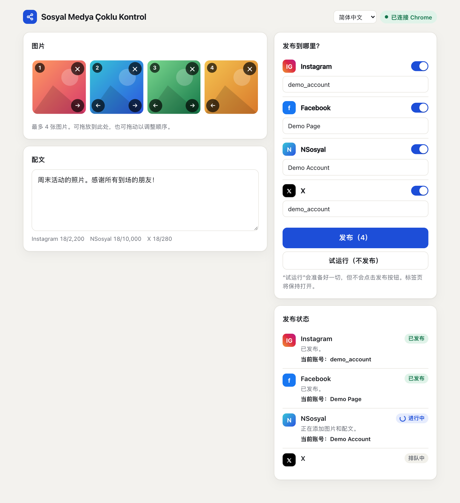
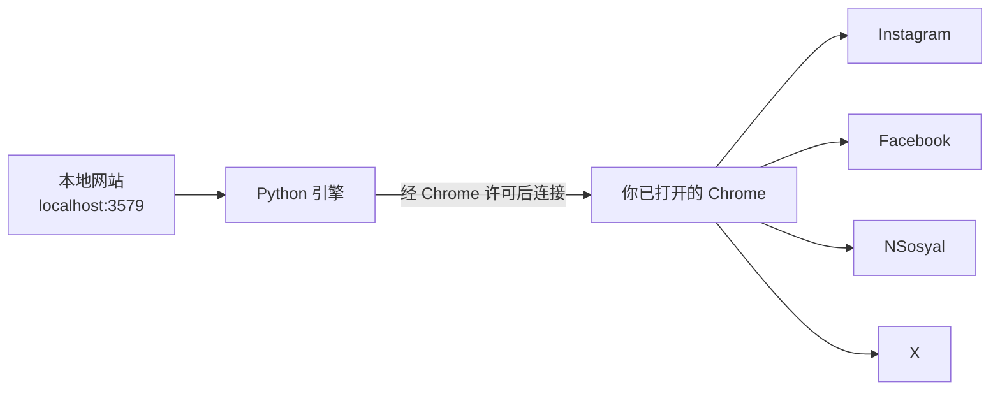

# Sosyal Medya Çoklu Kontrol

[English](../README.md) · [Türkçe](README.tr.md) · [Español](README.es.md) · [Português](README.pt.md) · [Français](README.fr.md) · [Deutsch](README.de.md) · [Русский](README.ru.md) · [العربية](README.ar.md) · **简体中文** · [日本語](README.ja.md)

在一个界面里准备好图片和文案，一键发布到 **Instagram、Facebook、NSosyal 和 X**。

程序运行在你自己的电脑上，使用已经登录了你账号的 Chrome。它不会索要或保存密码，也不会把你的数据发送到任何其他服务器。



## 功能

- **一个界面，四个平台：** 最多 4 张图片和一段文案，会发送到你选择的每个平台。
- **使用你自己的 Chrome：** 直接使用你现有的登录状态，不需要单独的窗口，也不需要重新登录。
- **试运行模式：** 准备好所有内容，但不会点击发布按钮。在你决定之前，不会发布任何内容。
- **账号检查：** 如果当前打开的账号与你保存的账号不一致，该平台连一张图片都不会添加。
- **防重复发布：** 如果无法确认发布结果，程序不会自动重试，而是提醒你自行检查。
- **故障隔离：** 某个平台失败时，其他平台会继续，出问题的标签页会保持打开。
- **登录失效时会等待：** 它会把登录页面切换到前台，等你登录后从中断处继续。
- **舒适的界面：** 支持拖放、图片排序、字数统计、深色主题，并适配手机宽度。
- **10 种界面语言：** 英语、土耳其语、西班牙语、葡萄牙语、法语、德语、俄语、阿拉伯语、中文和日语。它会跟随浏览器的语言，也可以通过页面顶部的菜单切换。

## 安装

**你需要：** [Google Chrome](https://www.google.com/chrome/) 和 [Python 3.10 或更高版本](https://www.python.org/downloads/)。在 Windows 上安装 Python 时，请勾选 **Add python.exe to PATH**。

1. 把文件夹解压到桌面之类的固定位置。不要在压缩包里直接运行。
2. 双击启动器：

| 系统 | 文件 |
|---|---|
| Windows | `baslat.bat` |
| macOS | `baslat.command` |

首次启动会安装所需组件，可能需要一两分钟，并且需要联网。之后网站会直接在 Chrome 中打开。

> 如果 Windows 显示“Windows 已保护你的电脑”，请选择 **更多信息 → 仍要运行**。如果 macOS 阻止运行，请前往 **系统设置 → 隐私与安全性 → 仍要打开**。

## 使用方法

### 1. 连接 Chrome（首次）

1. 在 Chrome 中打开 `chrome://inspect/#remote-debugging`。
2. 勾选 **Allow remote debugging for this browser instance**。
3. 在网站上点击 **连接 Chrome**，如果 Chrome 询问，请选择 **允许**。

每次重新打开程序时，Chrome 可能会再次请求权限。

### 2. 保存你的账号（只需一次）

1. 在 Chrome 中登录你要用来发布的账号。
2. 添加一张图片，点击 **试运行**。不会发布任何内容。
3. 如果状态区域显示的账号正确，点击 **保存此账号**。

保存的名称必须与网站显示的一致。Instagram 和 X 使用用户名。Facebook 和 NSosyal 使用显示名称，例如主页的完整名称。如果名称不一致，程序会在该平台停止，不会发布。**保存此账号**会为您填入正确的名称。

如果要以 Facebook 主页的身份发布，请先在 Chrome 中切换到该主页。

### 3. 发布

添加图片，写好文案，选择平台，点击 **发布**，并确认摘要。成功的标签页会在 30 秒后关闭。你可以通过 `data/ayarlar.json` 中的 `kapanmaSuresiSn` 值来修改这个时间。

### 状态的含义

| 状态 | 含义 | 该怎么做 |
|---|---|---|
| 已发布 | 帖子已确认发布 | 无需操作 |
| 就绪 | 试运行已完成，未发布任何内容 | 检查标签页，不要点击发布，直接关闭 |
| 等待登录 | 你已退出登录 | 在打开的标签页中登录 |
| 需检查 | 按钮已点击，但无法确认结果 | 先看看帖子是否已出现，再决定怎么做 |
| 错误 | 未发布 | 阅读提示信息。截图保存在 `data/hatalar` 文件夹中 |

## 工作原理



每个平台都会打开一个新标签页，并依次执行这些步骤：登录检查、账号检查、添加图片、输入文案、发布并确认结果。程序只会操作它自己打开的标签页。退出时它不会关闭 Chrome，只会断开连接。

## 文件夹结构

```text
sosyal-medya-coklu-kontrol/
├── baslat.bat            Windows 启动器
├── baslat.command        macOS 启动器
├── KULLANIM.txt          简短使用说明（土耳其语）
├── LICENSE               MIT 许可证
├── requirements.txt      Python 依赖
├── app/
│   ├── __main__.py       入口
│   ├── server.py         本地网站
│   ├── engine.py         发布引擎
│   ├── platforms.py      各平台专用步骤
│   ├── messages.py       可翻译的消息
│   └── static/           界面
│       └── i18n/         界面翻译
├── scripts/              打包和截图脚本
├── tests/                自动化测试
├── docs/                 README 翻译和截图
└── data/                 账号名称、错误截图（不会提交到 git）
```

如果某个平台更改了界面，需要修改的文件是 `app/platforms.py`。

## 安全与隐私

- 只能从这台电脑访问该网站（`127.0.0.1`）。来自其他网站的请求会被拒绝。
- 不会读取或存储密码、Cookie 和会话数据。程序只保存账号名称和 `data/hatalar` 中的错误记录。
- 勾选了 Chrome 的远程调试选项期间，电脑上的程序可能会请求连接 Chrome 的权限。不要批准你没有预料到的权限窗口。在共用电脑上，用完后请取消勾选。
- `data/hatalar` 文件夹中的截图和 `kayit.txt` 日志可能包含账号名称和账号内容。请仅与您信任的人分享。

## 已知限制和风险

> **重要：** 本程序使用的是网页界面，而不是平台官方 API。平台规则可能会限制这类自动化。例如，据报道，X 的规则会对通过网站进行的自动化操作施加处罚，最严重可至封禁账号。是否使用以及相应的责任由你自己承担。对于重要账号，请先查看相关规则。

- **网站语言：** 界面语言设置只会改变本程序。Instagram 和 Facebook 必须设置为英语或土耳其语，因为程序是通过文字来找到它们的按钮的。在其他网站语言下，程序会报错并停止，不会发布任何内容。NSosyal 需要使用土耳其语。X 不依赖网站语言。
- 启动器的黑色窗口只以土耳其语和英语显示消息。
- 翻译由 AI 撰写，尚未经过母语人士审阅。欢迎提出修改意见。
- 当平台更改界面时，相应步骤可能会失效。
- 它不会尝试绕过验证页面或机器人防护。这些需要你自己完成。
- 程序运行期间，电脑和 Chrome 必须保持开启。
- 每张图片的限制因平台而异。支持 JPEG、PNG 和 WebP，不支持视频。
- 请保持 Instagram 的 “Share to → Facebook” 选项关闭，否则帖子会在 Facebook 上出现两次。
- 如果部分平台发布失败，请先关闭已发布成功的平台，再点击**发布**，否则帖子会在这些平台上出现两次。

### 测试状态

| 范围 | 状态 |
|---|---|
| 自动化测试（使用模拟网站），包括全部 10 种界面语言 | 通过 |
| 在真实网站上的准备、多图和账号检查（macOS，土耳其语网站） | 已在试运行模式下试过 |
| 在真实网站上点击发布 | 在 Windows 上的一次实际测试中成功 |
| 在 Facebook 主页模式下读取账号 | **尚未试过** |
| 在 Windows 上运行 | 在一次实际测试中成功 |

第一次真正发布，请只选一个平台，并用一条无关紧要的帖子。

## 疑难解答

| 问题 | 解决办法 |
|---|---|
| "Python 3.10 or newer was not found" | 安装 Python。在 Windows 上，请勾选 **Add python.exe to PATH** |
| “无法连接到 Chrome” | 检查 Chrome 是否已打开、选项是否已勾选、权限窗口是否已批准 |
| “无法读取当前账号，已为安全起见停止” | 放大 Chrome 窗口，让网站的侧边菜单可见 |
| “打开的账号不正确” | 在 Chrome 中切换到正确的账号，或修改已保存的账号名称 |
| “未找到发帖界面” | 把网站语言设置为英语或土耳其语。如果已经是，可能是网站界面发生了变化：请查看 `data/hatalar` 文件夹 |
| 端口已被占用 | 程序已经在运行。请访问 `http://localhost:3579` |

## 开发

```bash
python3 -m venv .venv
.venv/bin/python -m pip install -r requirements.txt
.venv/bin/python -m app
```

测试不会接触真实账号或你的 Chrome。它们使用带临时配置文件的独立 Chrome 和模拟网站：

```bash
.venv/bin/python -m unittest tests.test_end_to_end
```

打包的输出会写入 `dist/` 文件夹：

```bash
.venv/bin/python scripts/paketle.py
```

要添加新语言，请把它的文件放进 `app/static/i18n/`，并把它的名称加入 `app/static/index.html` 中的 `LANGUAGES`。测试会检查每种语言的键是否一致。

## 许可证

[MIT](../LICENSE)。本软件不附带任何担保。
